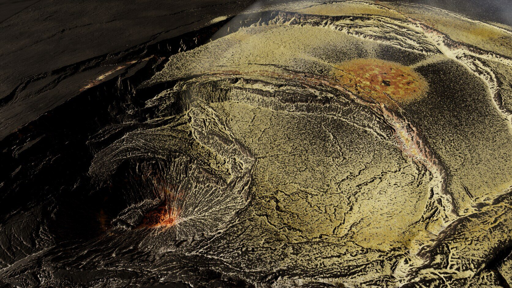
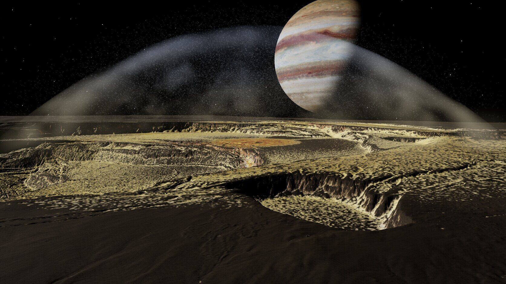
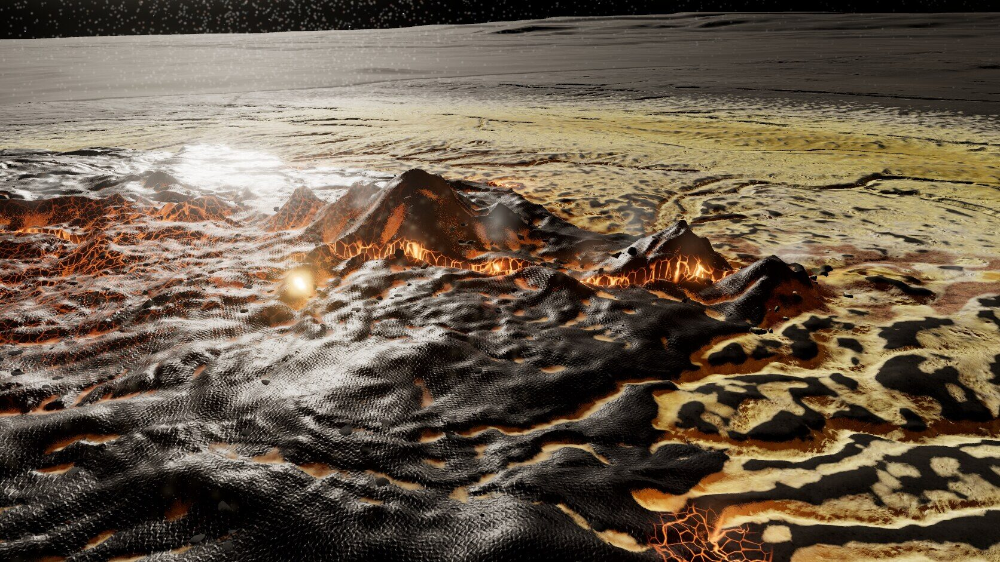
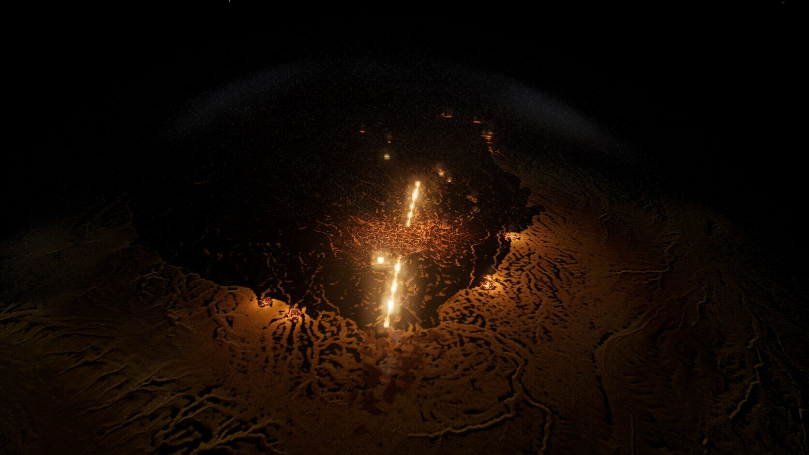
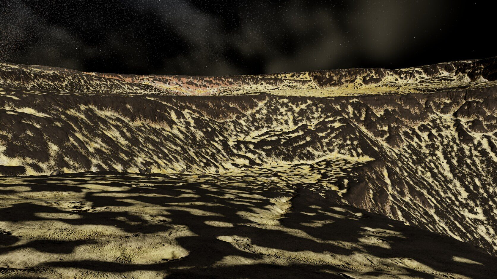
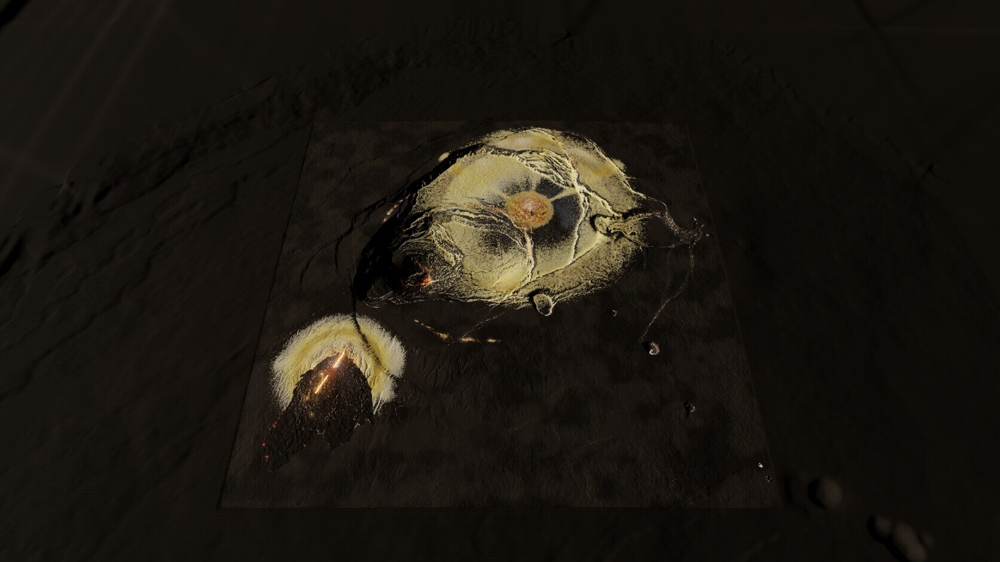

# Io scene A ("Kīlauea patera"), round 1

Page: `io-a.html`, served at **[endpoint removed] (`npx vite   `[path removed]`?view=<name>&t=<hour>&exposure=<x>&debug=<n>&capture`.

Code `[path removed]`, assets `[path removed]`, bake scripts `[path removed]`, work data `[path removed]`. Iteration log: [LOG.md](LOG.md). Sources and licences: [CREDITS.md](CREDITS.md).

Progression of the gameplay camera, it01 → it04 → it12 → it18: [shots/progression-gameplay.jpg](shots/progression-gameplay.jpg). All captures: `[path removed]` (the final set is `025-it18-*`).

## What was built
A 7.168 km square map of the real Kīlauea summit, 1 m lidar used directly: the 2018 down-dropped block with its stepped ring-fault benches, the ~500 m deep Halemaʻumaʻu pit, the caldera floor and walls, Keanakākoʻi, part of Kīlauea Iki at the east edge, and the Kaʻū desert flank with the SW rift in the south-west. A 28 km apron of coarse real lidar surrounds it for the overview.

Added on top:
- **A compound flow field** on the SW-rift flank: 22 flow units spread by a cellular automaton from two en-echelon fissure segments, with real Etna 2004–05 channel/levee relief and Big Obsidian pressure ridges (scaled to basalt size) inside the lobes. Two tube skylights.
- **A spatter-cone row** from the Great Rift DEM on the upper fissure segment.
- **Active lava, kept small:** two incandescent fissure slots (analytic, flickering), seven glowing cone throats, thin glowing crack networks on the youngest crust near the vent, hot breakouts at lobe fronts, a crusted lava-lake glimpse with a hot margin deep in Halemaʻumaʻu, two skylights. A baked lava-irradiance map lights the surrounding ground; a few point lights and bloom; screen-space heat shimmer.
- **Sulfur:** an offline Io-ballistic deposit simulation (two plume vents, 4.5 M particles, three/two eruption episodes of different speed and age, terrain collision on a 2 m grid), 109 fumarole clusters along six fault polylines (including the real Sulphur Banks ring fault), and SO₂ cold-trap frost from horizon-shadowed daily insolation. Coloured in the Dallol palette with the kit's Dallol scan textures; crusts fill the real lidar micro-lows first, streak down slopes and crack into polygons when thick.
- **Plumes:** a raymarched umbrella volume (canopy shell, falling curtain at the deposit ring, column) plus ballistic GPU particles with the same parameters as the simulation; fumarole puffs, ground dust, outgassing over hot lava.
- **Scatter:** 13 scanned meshes from the Io kit (~38 k instances): talus under walls, blocks and slabs on the flow, bombs around the cones, sulfur blocks in hot deposits, Dallol mounds/pillars on fumarole cores.
- **Light:** low hard sun with cascaded shadow maps (4 cascades to 9 km), time-of-day slider, Jupiter (19.5° across, phase-lit) with a warm Jupiter-shine fill, black sky with stars, ACES tone mapping.

### Real data vs procedural
| Element | Source |
| --- | --- |
| Base terrain, walls, benches, pit, apron | **Real** 2019 USGS lidar, 1 m (roads/buildings inpainted) |
| Flow-surface relief inside the lobes | **Real** Etna 2004–05 and Big Obsidian lidar, detrended and rotated |
| Spatter cones | **Real** Great Rift lidar strip |
| Flow outlines and thickness | Procedural (cellular automaton on the real topography) |
| Fissure/vent/lake/skylight positions | Our design (only the Sulphur Banks fumaroles are at a real fumarole site) |
| Deposits, frost, fumarole crusts | Procedural simulation; texture detail from the real Dallol scan |
| Scatter meshes | **Real** scans (kit); placement procedural |
| Lava glow, plumes, particles | Procedural |

## Bake pipeline (`[path removed]`)
One-off inputs: `ept_dem.py` (EPT ground points → 1 m grid: whole map depth ≤ 9, centre depth ≤ 10, apron depth ≤ 6 at 16 m), the OSM extract, `bake_apron.py`, `pack_textures.py` (texture arrays from the kit).
1. `merge_dem.py` – centre grid into the map grid (60 m feather).
2. `prep_base.py` – hole fill, wall-safe despike, OSM road/building inpainting with transplanted lidar roughness.
3. `kitbash.py` + `kitbash.json` – flow CA, Etna/Big Obsidian relief, Great Rift cones, fissure slots, skylights, lake; lava emission masks, lights, gas sources.
4. `horizon.py` – 16-direction horizon angles (4 m) for sky visibility and insolation.
5. `deposits.py` + `deposits.json` – ballistic plume simulation, fumaroles, cold traps (all parameters in the JSON).
6. `bake_rocks.py`, `bake_scatter.py` – kit meshes + LODs, instance placement.
7. `bake_maps.py` + `scene_config.json`[path removed]`scene.json` (views, vents, lights).
8. `bake_mesh.py` – error-bounded quadtree terrain (8 processes, ~25 min).
9. `bake_export.py` – game-port export.
Heavy steps take `flock [path removed]`. A full rebake from step 3 is ~35 min.

## Game-port export (`[path removed]`)
`README.json` documents every file. `height_1m.png` (16-bit, 7168², with `height_1m.json`: frame, CRS EPSG:6635 bounds, vertical range), `material_2m.png` (fresh flow, 'a'a, cliff, flow age), the browser's `[path removed]` (AO/sky, flow, TPI), `[path removed]` (deposit amount, Dallol hotness, frost, fumarole halo), `[path removed]` (lava emission, irradiance, fumarole heat, tubes), `[path removed]`; `features.json` (plumes with sim parameters, fumarole polylines, fissures, glowing vents, cone vents, lava lake, pits, lights, gas sources, cameras); `scatter.json` (38 k instances + rock definitions with licences).

## Triangles and frame rate
RTX 4070 SUPER via Chrome/ANGLE-Vulkan, 1920×1080, MSAA 4×, bloom, CSM 4×2048, uncapped (`[path removed]`, vsync off):

| Camera | Terrain tris | Scatter tris | Total in view | rAF fps |
| --- | --- | --- | --- | --- |
| close (350 m) | 188 k | 68 k | 256 k | 252 |
| **gameplay (2350 m, 40°)** | 244 k | 153 k | **397 k** | **182** |
| overview | 16 k | 2 k | 18 k | 487 |
| wall hero | 770 k | 156 k | 926 k | 175 |
| vent + plume hero | 471 k | 128 k | 599 k | 167 |
| lava night | 144 k | 102 k | 246 k | 164 |

The gameplay camera is under the 500 k budget at about 3× the 60 fps requirement on this GPU. The terrain stores 7.8 M triangles over all levels; the quadtree draws 8–25 nodes per view. Shadow passes re-draw the visible set per cascade, which the counts above do not include.

Assets: 159 MB loaded by the browser (mesh 79, maps 50, textures 13, scatter 11, other 6), plus 49 MB of export-only files. That is about 6 % over the ~150 MB target for the browser part.

## What works
- **The real lidar.** The stepped benches, the pit, the ring faults and the crisp wall faces read at every camera; quadric decimation keeps wall edges as mesh edges, and the geometric normal takes over on steep faces, so nothing is softened.
- **Contrast and structure.** Dark basalt with bright, sharp-edged crusts that follow the real micro-relief (crack lines, lobe margins, fault scarps), concentric colour zones around vents and fumaroles.
- **Night shot.** Thin fissure slots, small glowing throats, crack networks on young crust, baked lava light on the ground; no blobs or square sprites.
- **Plume.** The vent hero shows a large faint umbrella with a curtain landing on the simulated ring.
- **Performance** has a lot of headroom.

## What doesn't (yet)
- **Deposits still cover too much of the caldera floor** at the gameplay camera: it reads as one large yellow field with fine dark speckle, rather than bright patches on a mostly dark floor. The plume's red/orange apron is still a fairly regular disc from above. The simulation needs less fallout mass on the floor and more variation between episodes; the shader's coverage threshold could be tied to the particle hit density, not only to the smoothed amount.
- **Pit and wall faces** (wall hero) carry too much sulfur streaking; the lava-layer banding is weak. Wall sulfur should be limited to ledges and a few bands.
- **The flow field and the fissure are off the gameplay camera** (they are in the SW flank, ~2.5 km from the caldera). Only the close and night cameras show them.
- **Scatter is hard to see at gameplay range.** Thousands of blocks are drawn, but at 2.3 km they are 2–6 px and dark on dark.
- The **apron** is plain dark ground and the map edge is visible as a seam in the overview (deposits and detail stop at the square).
- **Heat shimmer** is barely perceptible; the umbrella volume can read like a smooth glass dome when looking up through it.
- Scan-faithful **close-up texture** is limited by 1 m lidar: at 350 m the ground shows the texture stack, not new geometry.
- **Frame times** were measured headless on this machine; the owner's GPU was not tested.

## Next steps
1. Thin the floor deposits: lower fallout mass on the caldera floor, keep it on rims, lee sides and cracks; make the hot apron patchy with episode-specific azimuth bias.
2. Walls: sulfur only on ledges (normal.y) and in 2–3 bands per wall; stronger dark/light basalt layering.
3. Put a second, small active flow and fumarole field inside the gameplay frame (caldera floor east of the block), or move the gameplay camera to frame both the pit and the flow.
4. Scatter: larger, lighter-toned talus aprons under the bench scarps so the blocks read at 2 km.
5. Feather the map edge into the apron (carry deposits and the normal map out 200–300 m).
6. Optional: a Tarawera chasm or Tolbachik pit kit-bash (not done this round).

## Proposed route into Godot
1. **Terrain.** Import `[path removed]` and rebuild in Godot with the same quadric quadtree (the `bake_mesh.py` output can also be exported as GLB per node), or use a clipmap terrain plugin on the 1 m heightmap with the 1 m normal map. Keep skirts and a screen-space error LOD as here.
2. **Material.** Port the terrain shader as one spatial shader: texture arrays for the kit layers (anti-tiling sampling), the 2 m mask textures, threshold-based crusts with derivative filtering, analytic fissure/vent emission from `features.json` as uniform arrays. Godot's `Texture2DArray` and `textureGrad` map directly.
3. **Lighting.** DirectionalLight3D with PSSM 4 splits for the sun, a dim warm DirectionalLight3D for Jupiter-shine, glow (bloom) on the emission, ACES; baked irradiance multiplied into the ambient term. A few OmniLight3D at the lava lights.
4. **Scatter.** MultiMeshInstance3D per rock and LOD from `[path removed]`, with Godot visibility ranges for LOD switching; the kit GLBs import directly.
5. **Plumes.** GPUParticles3D with a custom process shader using the same ballistic equations (no drag, g = 1.796), plus the umbrella as a FogVolume or a raymarched mesh shader; fumarole puffs as small particle emitters at `features.json` positions.
6. **Pipeline.** Keep the Python bake as the asset build; the game reads only the export folder.
