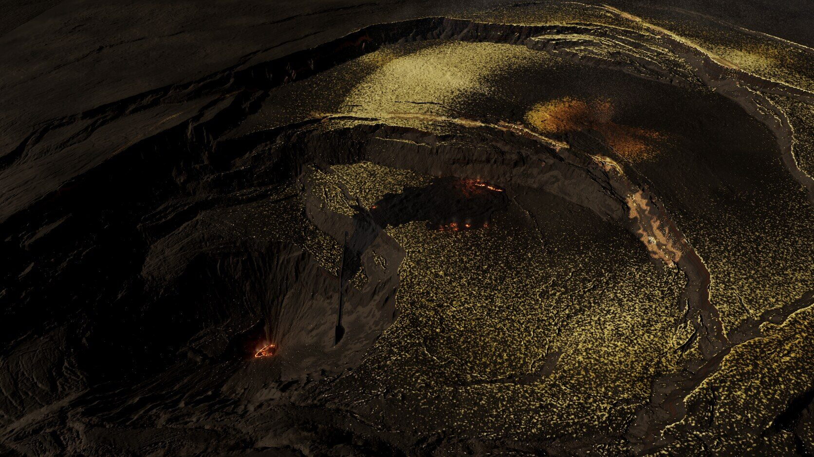
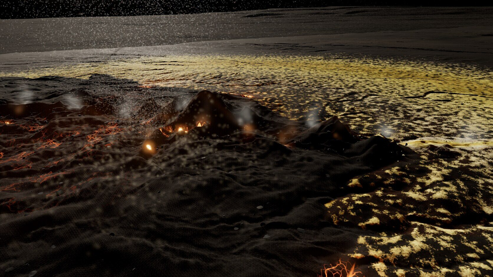
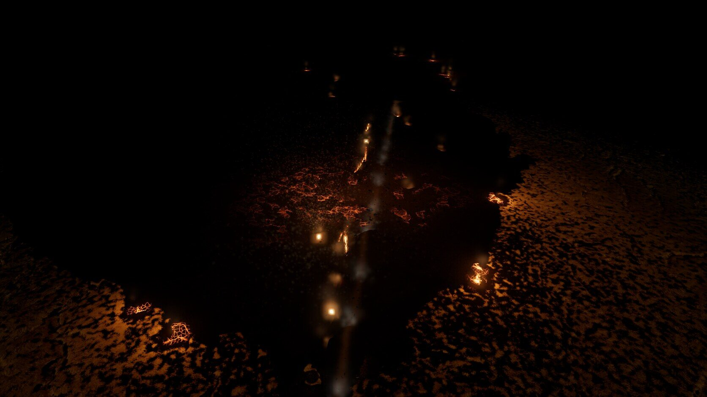
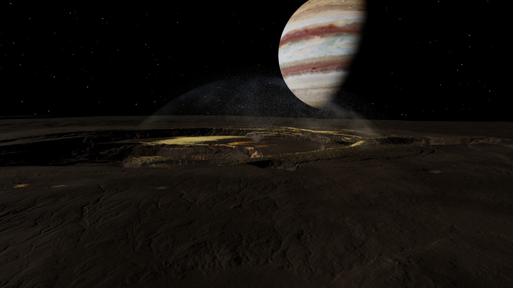
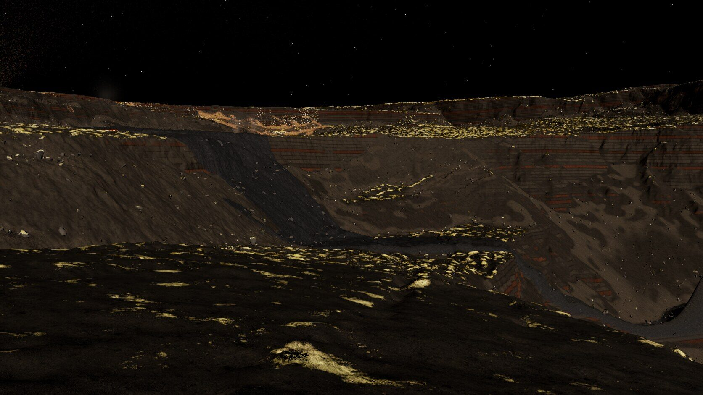
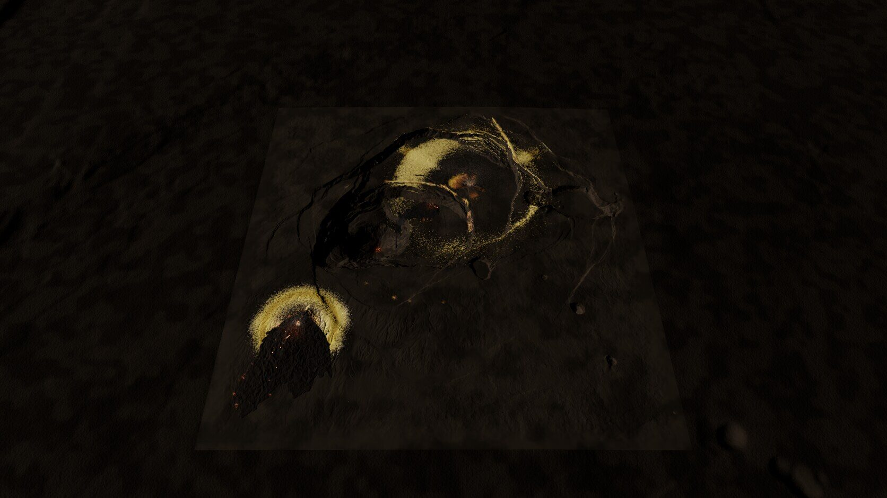

# Io scene A ("Kīlauea patera"), round 2

Same page and server: **[endpoint removed] Round 1 is described in [ROUND-1.md](ROUND-1.md); per-iteration notes are in [LOG.md](LOG.md) (round 2 section). The real lidar terrain is unchanged except for the new caldera-floor flow and the re-cut fissure slots.

Before/after (round-1 it18 left, round-2 r2-11 right; gameplay top, night bottom): [shots/r1-vs-r2.jpg](shots/r1-vs-r2.jpg). Final captures: `[path removed]`; all round-2 captures are `026`–`039`.

## What changed, by review point
1. **Sulfur coverage and pattern.** The mid-frequency blob noise is gone from both the bake and the shader. Coverage now comes only from the simulation, in three forms: (a) concentric plume zones with soft large-scale falloff, (b) narrow continuous bands along the ring-fault fumarole lines (core ~5 m, halo ~17 m, iron/salt fringe ~35 m, strength varying along the fault), (c) faint frost in cold traps. The crisp edge comes from the Dallol scans' own height at metre scale: a crust fills the micro-lows first, so a cell with 30 % simulated coverage shows 30 % of its micro-relief crusted. By the simulation estimate about 30 % of the flat caldera floor in the gameplay frame is bright; the rest reads dark basalt. The hot red apron is lobed (proximal clasts leave in jets) and mottled with dark rock showing through.
2. **Walls.** Stacked beds 2–8 m thick of dark grey basalt and reddish-brown scoria, with thin dark contacts, warped slowly along the wall. Sulfur only on ledges (bench tops from the 1 m normal map) and a few fumarole streaks; vertical faces carry no crust patches.
3. **Plume.** Scaled to its deposit (canopy radius ~1.6 km, top ~0.9 km above the vent for the 62 m/s caldera plume; the umbrella shape follows the analytic Io-ballistic envelope). The volume is faint, has no column, and is lit mainly in forward scattering and where it crosses Jupiter; fine particles carry the particulate look; the curtain lands on the simulated ring. The rift plume is dimmer still.
4. **Night fissures.** En-echelon segments 22–60 m long, offset and rotated, 30–50 % dark; each lit slot has a jagged centreline, varying width, crust bridges, intensity changing along its length and spatter clots on the lips. The square glow sprites were bloom artefacts of extreme HDR values; emission is now bounded.
5. **Lava in close-up.** Roughness 0.82–0.95 on fresh lava; glassy sheen only in rare small pahoehoe patches; more 'a'a (kit `basalt-aa-clinker`) on the SW flow and twice the clinker scatter; cone flanks are scoria and spatter, with glow only in the throats and on a sparse subset of crust plates. Terrain specular reduced (dusty basalt) so low sun no longer gives a plastic sheen.
6. **Framing.** A small fresh flow now erupts from a 250 m ring-fault fissure at the north-east foot of the 2018 block and spreads west across the block floor, inside the gameplay frame (camera convention unchanged).
7. **Scatter.** Talus blocks 2–8 m, denser and lighter-toned, in 55 m aprons under walls and bench scarps; the aprons themselves have a lighter rubble ground tone. Tighter scatter LODs to stay in budget.
8. **Overview seam.** The apron is resampled onto a grid aligned with the map edge and meets the map's own edge heights; it uses the map's base material and a light procedural bump; the map's 1 m normals fade over its outer 450 m. The edge is much softer but still faintly visible as a change in fine detail.

## Triangles and frame rate
RTX 4070 SUPER, Chrome/ANGLE-Vulkan, 1920×1080, 4× MSAA, bloom, CSM 4×2048, vsync off (`[path removed]`):

| Camera | Terrain | Scatter (instances) | Total | rAF fps |
| --- | --- | --- | --- | --- |
| close | 254 k | 67 k (1.6 k) | 321 k | 155 |
| **gameplay** | 244 k | 181 k (4.5 k) | **425 k** | **162** |
| overview | 16 k | 1 k | 17 k | 390 |
| wall hero | 780 k | 198 k (4.9 k) | 978 k | 169 |
| vent + plume | 252 k | 47 k | 298 k | 256 |
| lava night | 181 k | 131 k (3.2 k) | 313 k | 137 |

Gameplay stays under the 500 k budget. Assets: 159 MB loaded by the browser plus 49 MB export-only (unchanged from round 1 apart from `masks_c.png`, 1 MB).

## Export (`[path removed]`, refreshed)
No files renamed. Changes are listed in `README.json` → `changes.round2`: new `[path removed]` (talus apron, cone/scoria, fissure light); `features.json` fissures are now en-echelon segments with `intensity` and `halfWidthM` (they had `spots`/`phase`), plus a `fissureNote`; the height raster, `material_2m.png`, masks and `scatter.json` include the caldera-floor flow; `masks_a.a` (fine TPI) is kept but no longer used by the browser.

## What still doesn't work
- The sulfur pattern at the gameplay distance is a fine salt-and-pepper texture where the crusts are thin; it averages correctly but can look grainy. A distance-dependent blend to the average colour beyond ~1.5 km would calm it.
- The yellow umbrella zone is still mostly one smooth gradient at map scale; real Io deposits show more azimuthal structure (episodes with different directions); worth one more pass in `deposits.json`.
- The overview seam is softened, not gone; the context apron is plain dark ground.
- Scatter is readable as talus aprons rather than as individual blocks at 2.3 km.
- The heat shimmer is barely visible, and the umbrella still reads as a smooth shell where it crosses Jupiter.
- The close camera sits inside the rift plume's volume, so a faint haze remains in that view.

## Honest status
The base now reads as dark basalt with sparse, structured sulfur, layered walls and restrained lava; the main review complaints (camouflage blobs, glassy dome, neon fissures, plastic lava, no glow in the gameplay frame) are addressed. I would put it around 70 % of "looks finished".
