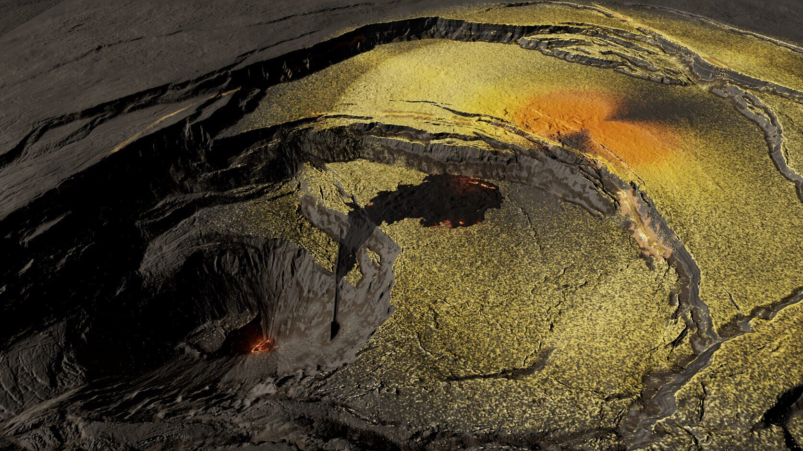
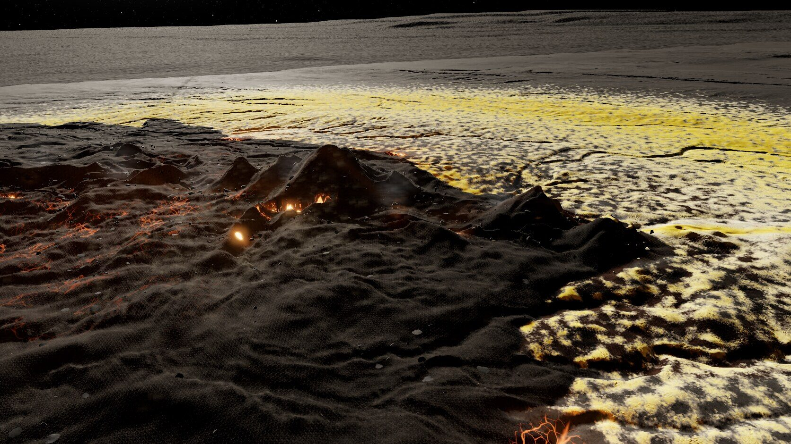
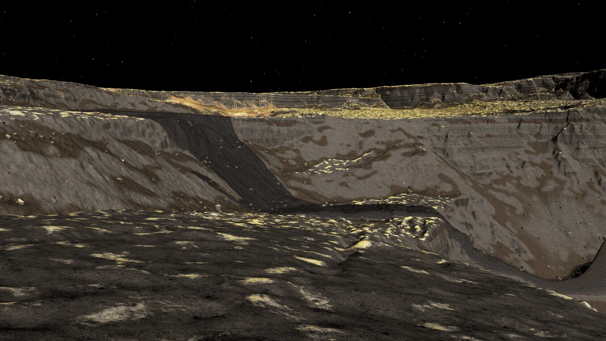
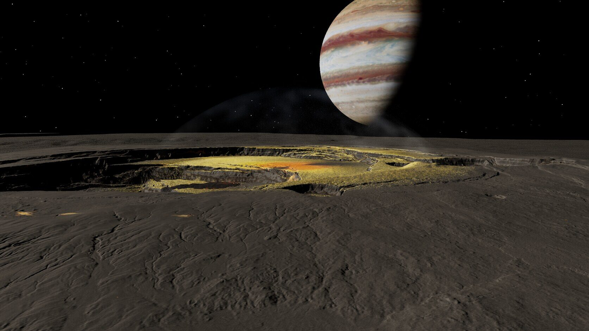
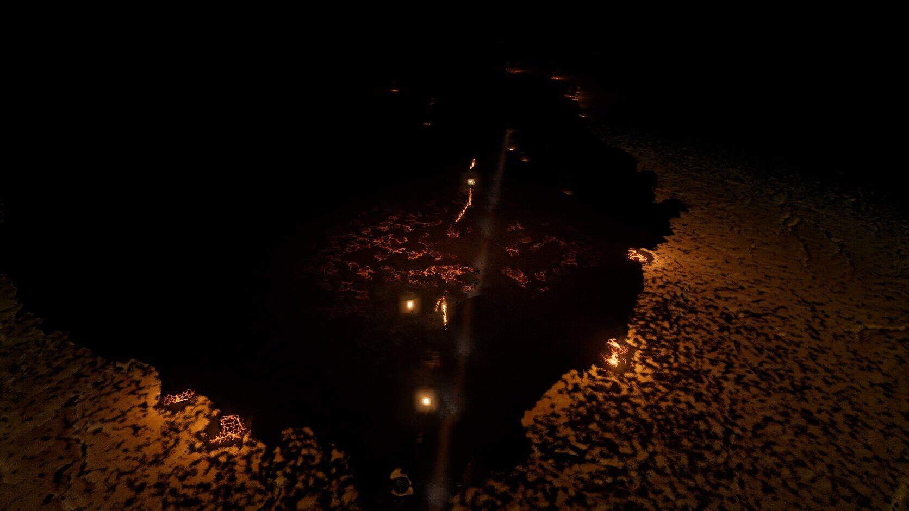
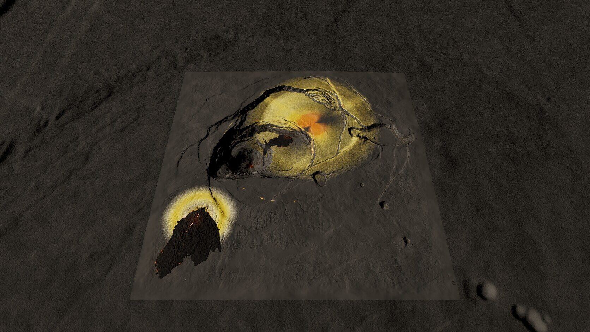

# Io scene A ("Kīlauea patera"), round 3

Page: **[endpoint removed] Earlier rounds: [ROUND-1.md](ROUND-1.md), [ROUND-2.md](ROUND-2.md); details per iteration in [LOG.md](LOG.md). Round 3 keeps the round-2 composition (dark base, plume zones, fault bands, en-echelon fissures, caldera-floor flow) and fixes the dull, muddy look.

Before/after (round 2 left, round 3 right; gameplay and wall): [shots/r2-vs-r3.jpg](shots/r2-vs-r3.jpg). Final captures: `[path removed]` (round 3: `040`–`046`, 7 iterations).

## Changes, by review point
1. **Exposure and colour.** Sun 3.2 → 5.2, exposure 1.4, neutral grey sky ambient instead of the brown one; basalt albedo now comes from texture luminance only (mid-dark grey, slight warm cast), the context apron uses the same. Sulfur is saturated (Dallol yellow, warmer, cream/white at the fringe); the main vent's red/orange apron is larger (more and faster proximal clasts, in 11 jets). Plume tint neutral instead of beige.
2. **Wall layering.** Bedding keyed to absolute elevation with a slight dip, so beds continue across benches; bed thickness varies 0.5–12 m (warped index), beds pinch out laterally and form lenses; mostly grey-on-grey tone steps; reddish-brown scoria only occasionally and desaturated; vertical cooling joints in the massive beds; contacts only on some beds and faint.
3. **Close-range crusts.** Crusts are height-blended into the Dallol micro-relief with a thickness gradation: a dusting halo, a thin paler rim, then thick saturated crust; the crust's normal is smoother than the rock and its AO lifted, so it sits in the lows instead of floating. Beyond ~1 km the coverage blends toward its average colour, which removes most of the salt-and-pepper grain at the gameplay camera.
4. **Plume particles.** Grains are 0.9 m, fade when sub-pixel instead of snapping to 1 px, and fade out within ~300 m of the camera (no snow in the close view).
5. **Fumarole puffs.** Larger but half the opacity, with streaky noise inside the sprite (wisps, not balls); ground dust likewise.

## Triangles and frame rate (1920×1080, RTX 4070 SUPER, uncapped)
| Camera | Terrain | Scatter | Total | fps |
| --- | --- | --- | --- | --- |
| close | 254 k | 67 k | 320 k | 143 |
| **gameplay** | 244 k | 182 k | **426 k** | **180** |
| overview | 16 k | 1 k | 17 k | 442 |
| wall hero | 780 k | 198 k | 978 k | 166 |
| vent + plume | 252 k | 47 k | 299 k | 251 |
| lava night | 181 k | 132 k | 313 k | 136 |

## Export
Refreshed, no renames. Only `[path removed]` changed (larger hot apron); everything else in round 3 is browser shading. Noted in `README.json` → `changes.round3`.

## Still open
- The red apron is a smooth fan with a shadow wedge from the scarp, not yet patchy like the reference art; the yellow umbrella zone is one gradient at map scale.
- The wall layering is subtle at the wall-hero distance (by design: grey-on-grey), and the steep pit walls still show the faceted mesh.
- The map edge is visible in the overview as a change in fine detail.
- The reference art is far more saturated and fully sulfur-covered; this map stays mostly dark basalt by the round-2 brief, so it reads calmer than the reference.

Status: around 75 % of "looks finished".
