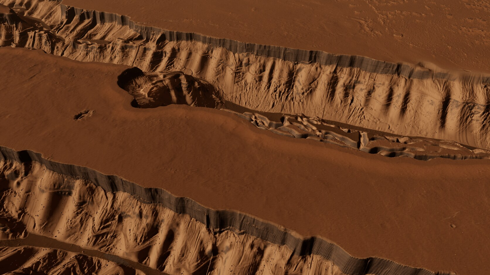
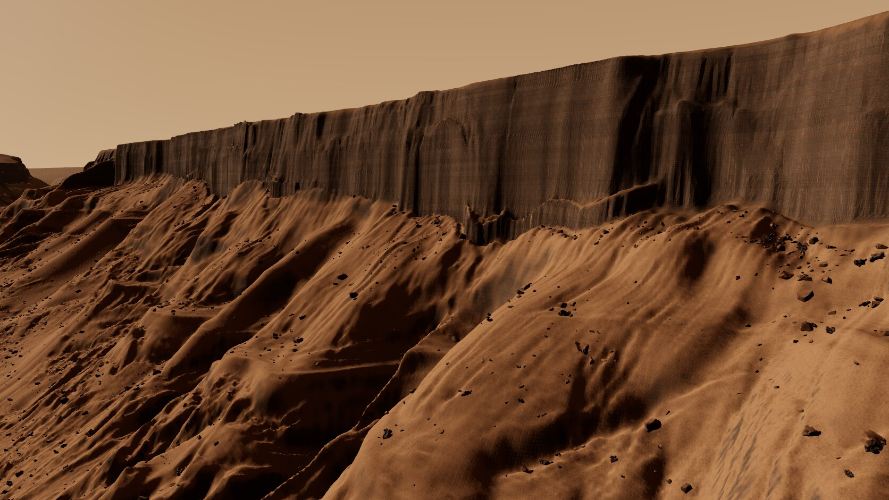
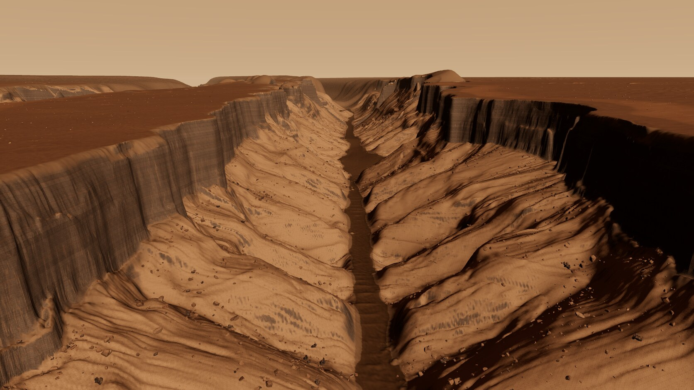
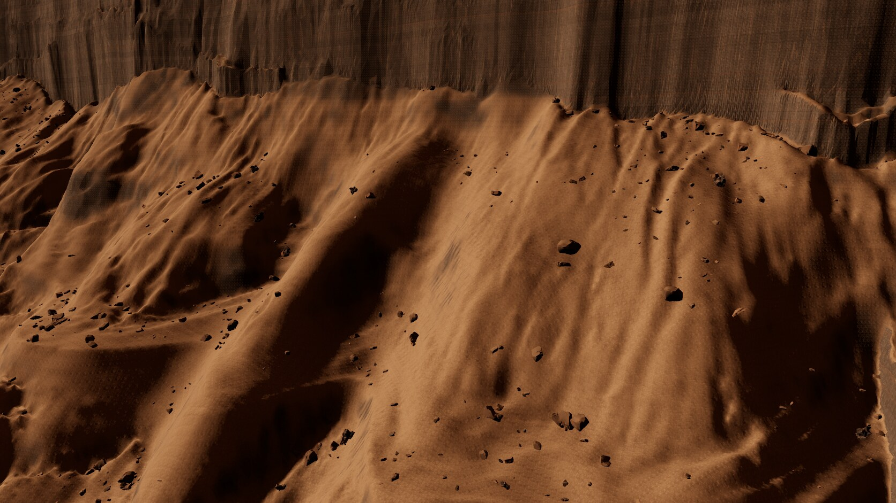
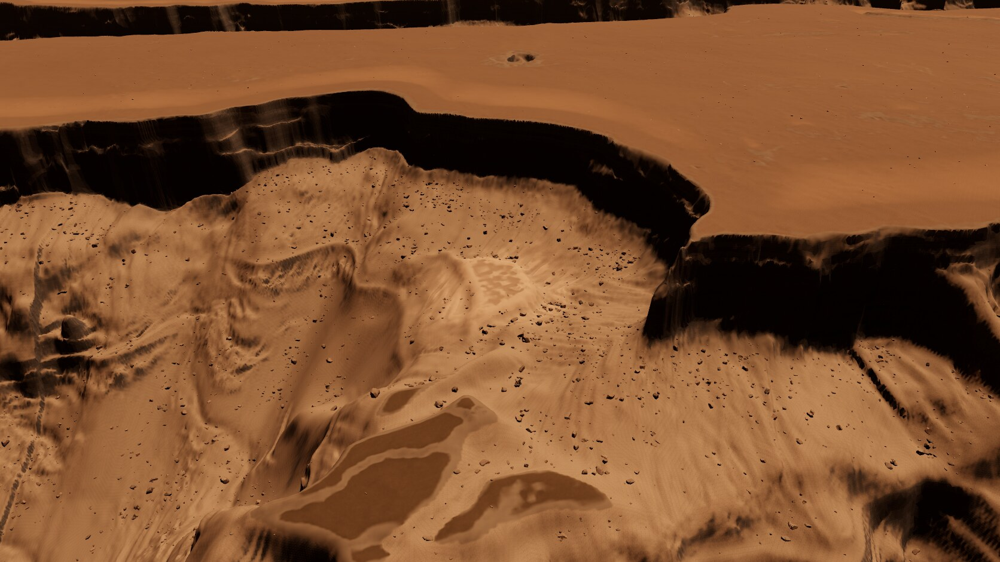
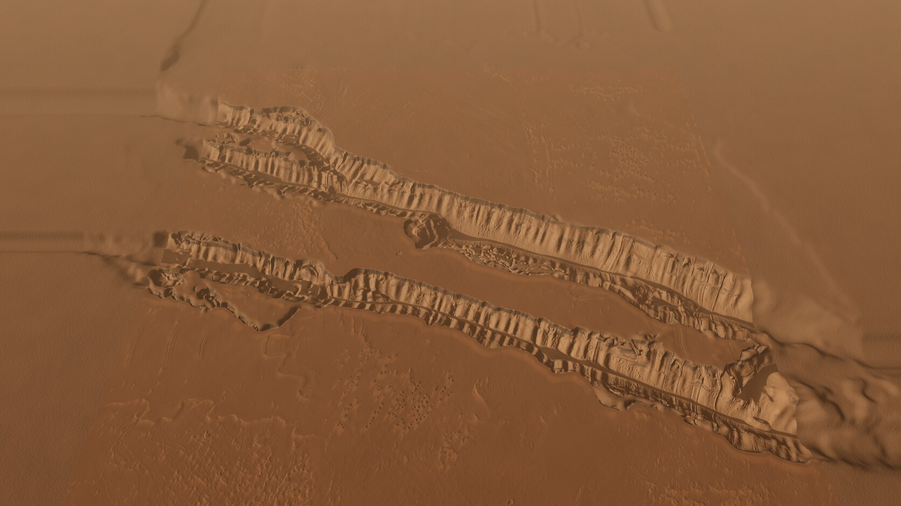

# mm-cerberus (Cerberus Fossae, new region `mars.cerberus_fossae`), round 1

Page: **[endpoint removed] (`npx vite   `, running).
Buttons switch the review cameras (close, gameplay, overview, wall hero, fissure hero, collapsed block + deposit).
The panel has time of day, exposure, haze, toggles (rocks, boulder trails, dust, gameplay masks, bloom), debug views
(dust/sand/streak, band/talus/platy, normals, thermal/deposit/hub, sky visibility, cones), wireframe and the LOD
threshold. Drag orbits, right-drag pans, wheel zooms, WASD/QE fly (shift fast). URL: `?view=<name>&t=<hour>&exposure=<x>&haze=<x>&gameplay=1&debug=<n>&capture`.

Code `[path removed]`, assets `[path removed]`, bake `[path removed]` (`run_all.sh`),
work data `[path removed]`. Iterations: [LOG.md](LOG.md). Sources: [CREDITS.md](CREDITS.md).

All captures: `[path removed]`; the final set is `015-r1-*` (progression of the
walls: `003-t2` -> `008-it6` -> `013-it8` -> `014-it9` -> `015-r1`).

## What was built
A 12.288 km square map centred on anchor A (10.30N 156.95E), north up, in a Mars-sphere azimuthal-equidistant frame.
- **Base (real):** the full HiRISE DTM DTEEC_009280_1905 strip (7.5 x 15.7 km COG at USGS, not just the 6 x 7 km
  io-data crop), warped at 1 m: it covers the whole N-S extent of the map, 5-7 km wide through the middle. The CTX 20 m
  mosaic fills the E/W margins: despiked, smoothed (its pair-mosaic seams showed as metre steps), moved onto the HiRISE
  heights (HiRISE - CTX drifts from 48 m in the N to 84 m in the S; quadratic fit, 2.7 m residual), with 1 m HiRISE
  relief transplanted along the trough direction. Plains, floors, dunes, the collapsed block and the large-scale wall
  shape are real HiRISE (CTX in the margins).
- **Walls (kit-bashed, the main work):** every wall cell is rebuilt by a depth remap onto real Earth wall modules:
  Snake River canyon (x2.6 and x1.6), Dry Falls benches (x2.4) and Malad Gorge (x2.8), unrolled from 1 m USGS lidar, plus
  the Kilauea 2018 Halemaumau talus chutes on a 36 deg talus below each module. The real (smoothed) wall depth sets the
  large-scale shape; the modules give the crisp cliff band at the real lip, ledges, buttresses and blocky talus; their
  1:1 lidar high-pass adds metre-scale crags; a spur-and-gully rhythm (after DTEEC_017719) and softmax-blended module
  variants vary the walls along their length. Lip, band and talus stay crisp (no smoothing of the result).
- **Plains:** HiRISE Amazonis platy-flow relief (DTEEC_004202, high-pass) on the plains (full weight in the CTX
  margins, 25 % over the real HiRISE plains), two rootless-cone clusters from the Athabasca cone field
  (DTEEC_001606), dust and dark basaltic sand in the lows and on the trough floors, bright wind streaks downwind of
  cones, rims and ridges (wind from azimuth 25 deg).
- **Rocks and trails:** Mars kit scans (regraded, dust tops; chimney rocks dropped, one-sided Mastcam-Z rocks sunk),
  4 LODs (2000/500/100/28 tris), ~207 k instances: talus blocks concentrated at the band foot, ledge blocks, floor and
  plain boulders, platy slabs, cone blocks, and ~1,060 fall boulders that rolled down the steepest descent of the
  final DEM, each with a boulder trail (ribbon decal of bounce marks).
- **Look:** measured natural-colour palette (palette-locked kit textures), butterscotch sky with a blue-ish aureole
  around a small hard sun, distance haze matching the horizon, hard CSM shadows, low afternoon sun (16.4 h, ~24 deg).
- **Gameplay:** hubs on the N plain (x 2000, z -3900) and S platy plain (x -2200, z 4300); the steep-only deposit on
  the real collapsed-block bench in the northern trough (x -770, z -690, ~150 m below the rim; light-toned bedrock);
  10 possible thermal cells on the deepest floor line of the fossae (dust-free dark young basalt); the inter-fissure
  plateau as expansion site. All in the masks and `features.json`; the "gameplay masks" toggle shows them.

### Real data vs procedural
| Element | Source |
| --- | --- |
| Plains, floors, dunes, collapsed block, wall plan and large-scale wall shape (core) | **Real** HiRISE DTEEC_009280 1 m |
| E/W margins layout | **Real** CTX 20 m (smoothed; 1 m relief transplanted from the HiRISE strip) |
| Cliff band, ledges, buttresses, talus blocks and chutes | **Real** Earth lidar (Snake River, Dry Falls, Malad Gorge, Kilauea 2018), placed procedurally (depth remap, variant blend, spur rhythm) |
| Platy-lava relief, rootless cones | **Real** HiRISE (Amazonis 004202, Athabasca 001606), stamped procedurally |
| Masks (dust, sand, streaks), thermal cells, sites, rock placement, boulder trails | Procedural / our design |
| Rock meshes | **Real** scans (Mars kit), regraded |

## Bake pipeline (`[path removed]`)
One-off: `[path removed]` (GDAL warps of the HiRISE COG and the CTX mosaic into the scene
frame), `pack_textures.py` (Mars kit texture arrays).
1. `prep_base.py` - CTX despike/smooth/align, HiRISE-into-CTX blend (220 m feather), CTX-margin detail transplant.
2. `wall_modules.py` - unroll the Earth wall runs and the Kilauea pit talus into module strips.
3. `walls.py` + `kitbash.json` - plateau (closing, bias removed), depth remap onto the modules, along-wall coordinate
   (axis projection + Poisson deviation), spur rhythm, micro crags.
4. `kitbash.py` - platy and cone stamps; masks (dust, sand, streaks, band, talus, platy, cones, thermal cells,
   deposit, hubs, buildable); `sites.json`.
5. `horizon.py` (8 m, 16 dirs) -> 6. `bake_rocks.py`, `bake_scatter.py` (+ trails) -> 7. `bake_maps.py` ->
8. `bake_apron.py` -> 9. `bake_mesh.py` (6 levels, error-bounded quadtree, 11 processes, ~25 min) -> 10. `bake_export.py`.
Steps 1-8 take ~6 min. Heavy steps take `flock [path removed]` by default (`LOCK=" "` skips it in full-force hours).

## Game export (`[path removed]`)
Same layout as the Io exports. `README.json` documents every file: `height_1m.png` (16-bit, 12288 x 12288, + json:
frame, CRS, areoid range), `material_4m.png` (cliff, buildable, floor, wall zone), `gameplay_4m.png` (hubs, deposit,
thermal cells, buildable), the browser's `[path removed]` (4 m) and `[path removed]`, `features.json`
(hubs, deposit with access note, expansion plateau, thermal cells, cone sites, troughs, trails reference, cameras, sun),
`scatter.json` (207 k instances + rock definitions). The Io importer (`io_scan_import.py`) needs the planned
generalisation: the mask channel layouts differ from Io's (documented in the README).

## Triangles and frame rate
RTX 4070 SUPER, Chrome/ANGLE-Vulkan, MSAA 4x, CSM 4 x 2048, uncapped (`perf.mjs`, 1920 x 1080):

| Camera | Terrain | Rocks | Total | GPU ms | rAF fps |
| --- | --- | --- | --- | --- | --- |
| close (350 m) | 303 k | 119 k | 422 k | 4.7 | 186 |
| **gameplay (2350 m, 40 deg)** | 440 k | 162 k | **602 k** | 3.5 | **268** |
| overview | 50 k | 0 | 50 k | 0.4 | 574 |
| wall hero | 425 k | 231 k | 657 k | 5.1 | 175 |
| fissure hero | 641 k | 346 k | 986 k | 4.0 | 175 |
| deposit | 669 k | 249 k | 918 k | 4.5 | 195 |

At the capture size (1672 x 941) the gameplay camera draws 489 k (373 k terrain + 116 k rocks, ~4,100 rocks). At 1080p
it is 602 k, ~20 % over the 500 k budget; frame time is far inside 60 fps. Stored terrain: 13.3 M faces over 6 levels.

Assets loaded by the browser: **231 MB** (mesh 157, maps 38, rocks 16, textures 11, heightfield 9) - over the
~150 MB target; the export adds 145 MB (height PNG 128 MB).

## What works
- The fossae read as Cerberus fossae at every camera: a crisp, dark, layered cliff band at the real lip, spur-and-gully
  walls below it with chutes and blocky talus, dark sand on the floors, the real collapsed block and benches.
- The wall rebuild is data-driven end to end (real HiRISE plan and depth, real Earth cliff and talus relief) and has
  no visible seams along the walls.
- Haze and butterscotch sky give depth in the low hero shots; lit faces and shadows separate.
- Performance has large headroom.

## Known problems
- **Over budget:** gameplay 602 k triangles at 1080p (489 k at 1672 x 941); browser assets 231 MB (mesh 157 MB).
  Next: leaf error 0.9 -> 1.2 m on plains only, coarser L5 where the 1 m DEM is smooth; rock LOD distances.
- **Cliff face texture:** the band is crisp in geometry but its face still reads as a smooth "curtain" with fine
  vertical streaks at the close camera; the bedding is subtle. Needs real flow-by-flow relief (stacked benches at
  2-8 m) or the kit's wall-module meshes on the steepest stretches.
- **Lip offset:** on some HiRISE walls the rebuilt cliff starts 15-30 m outside the real lip (depth smoothing).
- **Map edge and apron:** the 12 km square shows against the CTX apron at the overview (shading and detail change);
  the CTX-margin walls are softer than the HiRISE ones.
- **Masks:** the deposit's light-toned patch and the sand lows read a little blotchy near the block (threshold
  edges); slope streaks were switched off (they read as grey dashes).
- **Rocks:** dark dots on light talus; few boulders are large enough to read at the gameplay camera; boulder trails are
  faint beyond ~1 km.
- **Thermal cells** are only a dark dust-free tint plus masks; no visual hint of warmth.
- Captures and timings are from this machine (headless); the owner's GPU was not tested.

## Next steps
1. Bring the band faces up to the bar: flow-by-flow stepped relief inside the band (Dry Falls tiers at 1:1), crag
   normal detail, kit wall-module meshes on the >70 deg stretches.
2. Budget: plain-only coarser leaves, mesh to <= 100 MB; rocks to ~150 k triangles at gameplay.
3. Fix the lip offset (per-wall lip correction from the unsmoothed DEM).
4. Feather the map edge into the apron (carry detail and the platy normal 300 m out).
5. Larger fall boulders and stronger trails on the lit walls; dust aprons under the ledges.

Status: about 60 % of "looks finished" (walls and composition there; close-range cliff faces, budget and the map edge
not yet).
