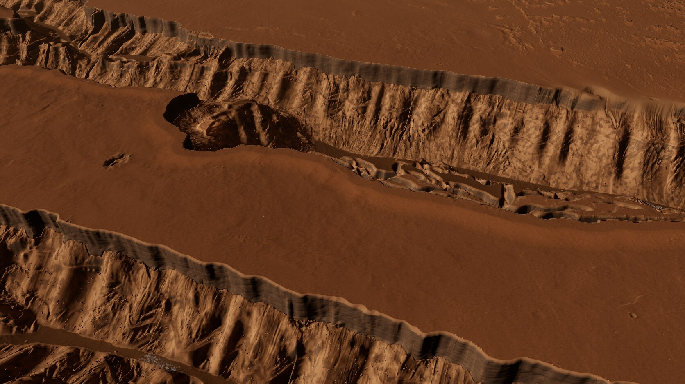
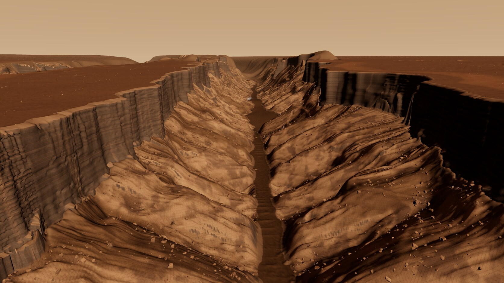
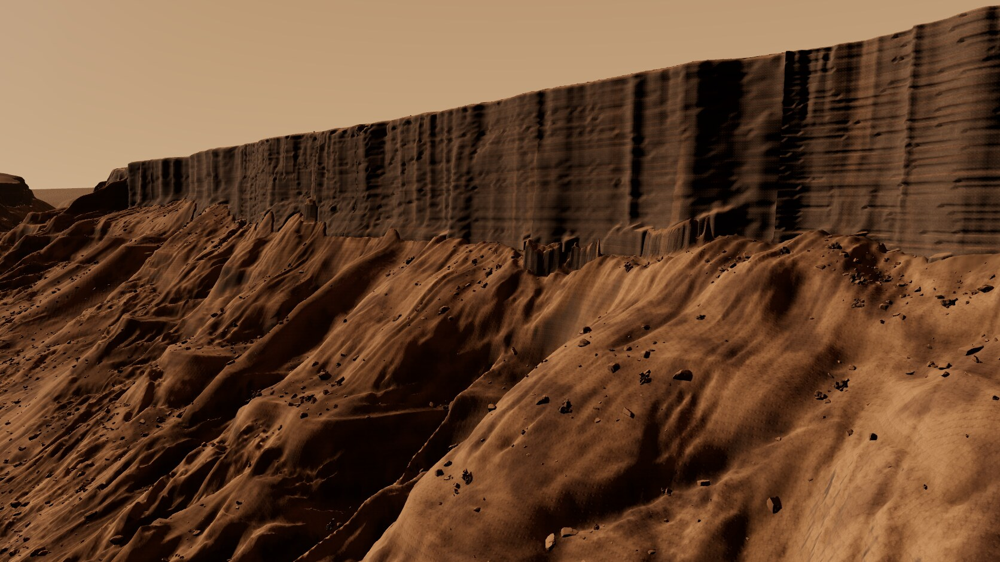
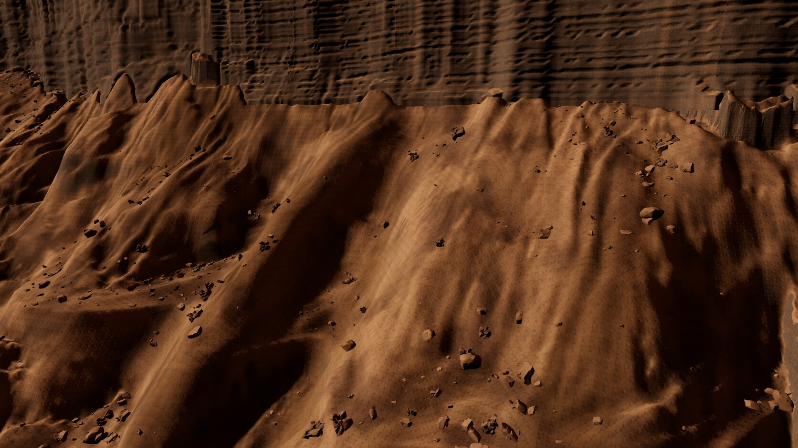
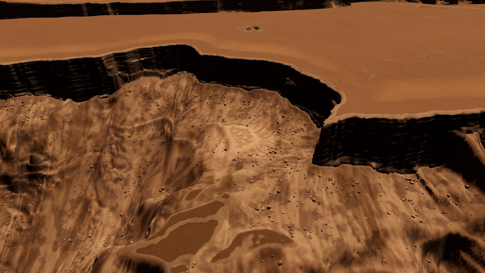
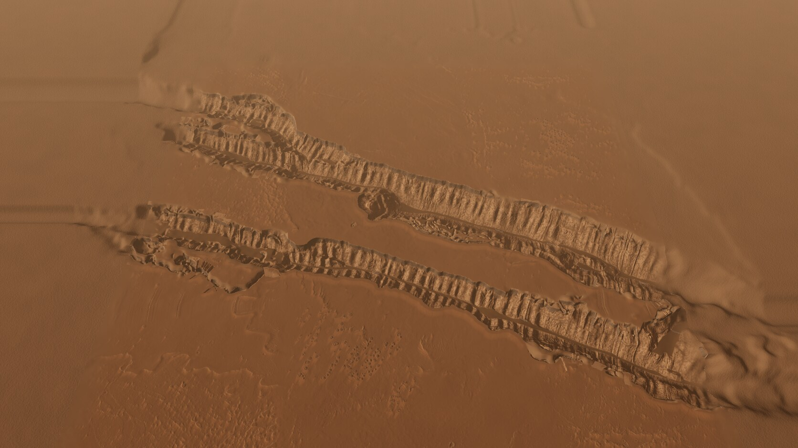

# mm-cerberus (Cerberus Fossae), round 2

Page: **[endpoint removed] (server running). New panel toggles: cliff band meshes, thermal
vapour. URL extras: `?modules=1` (kit wall modules instead of the ribbon band), `rtau=<px>` (rock LOD threshold).
Earlier round: [ROUND-1.md](ROUND-1.md); iterations in [LOG.md](LOG.md) ("Round 2"); sources in [CREDITS.md](CREDITS.md).

Final captures: `[path removed]` (round 2: `016`-`044`; quiet hours, every bake and
capture under `flock [path removed]`, one at a time). ~10 iterations.

## Changes by review point
1. **Cliff band faces.**
   - Tried first, as briefed: the kit wall modules (snake-a, snake-b, malad) placed along the lip contour
     (`cliffs.py`: 317 modules, yaw from the depth gradient, scale from the local drop, tops tucked under the rim, feet
     stretched into the talus, aprons, sides and skirts cut, ends folded into the plateau, terrain receded underneath).
     It did not work at the gameplay camera: a castellated row of separate boxes. The modules are also heightfield
     extrusions, so their near-vertical faces have the same stretched quads and vertical streaks (also in your kit
     review). Kept as an option (`?modules=1`), not the default.
   - Adopted **cliff-band ribbons** (`ribbons.py`, `ribbons.js`): the band is cut out of the heightfield and meshed on
     the wall itself, with columns every 2 m along the real lip and rows every 1.5 m of depth (283 segments). The shape
     per column comes from the rebuilt wall (HiRISE plan plus the Earth-lidar module profile). It carries stacked
     flows keyed to elevation (2-10 m beds, hard beds standing out up to 1.2 m), notched rubbly flow tops (ledges) and
     rounded columnar grooves in the massive beds. These are geometry, so they read as relief at every angle. The
     shading is world-space triplanar layered basalt with dust on the ledges, and never uses UVs.
   - The terrain behind the band is the wall surface shifted 4 m into the rock, so the heightfield never pokes through
     and loses its near-vertical triangles.
2. **Talus.**
   - Blocky scree texture (pebbly soil at its own scale), large dark basaltic-sand streaks and lighter dust tongues
     along the fall line, and dark gullies with dusty spurs (weak, from the topographic position).
   - New `bigtalus` group of 8,100 blocks, 3.5-13 m with power-law sizes, readable at the gameplay camera, plus
     ~1,600 fall boulders with trails.
   - Rocks are graded 42 % toward a dusty talus colour, with dustier tops.
   - On the way, three bugs made the talus look like marbled wood grain; each is fixed (LOG r2-10).
3. **Budgets.**
   - Gameplay at 1080p: **497 k triangles** (316 k terrain + 125 k rocks + 55 k band); it was 602 k.
   - Plains get adaptive LOD: nodes without walls have a 3x looser error target, and `prune_mesh.py` drops level 5
     wherever level 4 is already within 4 m. Terrain screen-error threshold 1.7 -> 3.6 px; rocks 2.2 px.
   - Browser assets: **160 MB** (mesh 70, maps 32, rocks + trails 16, band 17, textures 11, heightfield 9); was 231 MB.
   - Export height raster: **94 MB**, 3 cm steps (128 MB before).
4. **Lip and edge.**
   - The rebuilt cliff now starts at the real lip: where the unsmoothed DEM is still within ~2-5 m of the rim plane,
     the real surface is kept (`walls.py`).
   - The last 600 m of the map blend into the apron's colour and lose their normal-map detail (overview).
5. **Thermal cells.** Dust-free, warm-tinted dark floor patches, plus faint rising vapour (260 GPU points per cell,
   analytic motion, almost free).

## Triangles and frame rate (1920x1080, RTX 4070 SUPER, Chrome/ANGLE-Vulkan, uncapped)
| Camera | Terrain | Rocks | Band | Total | GPU ms | rAF fps |
| --- | --- | --- | --- | --- | --- | --- |
| close | 242 k | 139 k | 119 k | 500 k | 6.4 | 169 |
| **gameplay** | 316 k | 125 k | 55 k | **497 k** | 3.4 | **240** |
| overview | 82 k | 0 | 59 k | 141 k | 1.9 | 460 |
| wall hero | 318 k | 239 k | 82 k | 639 k | 4.6 | 163 |
| fissure hero | 351 k | 324 k | 124 k | 799 k | 3.6 | 166 |
| deposit | 542 k | 250 k | 106 k | 898 k | 4.6 | 175 |

## Export (refreshed; nothing renamed)
`README.json` -> `changes.round2` lists everything:
- `height_1m.png` uses 3 cm steps (same decode formula; `stepM`, `dataMaxElevationM` added);
- new `[path removed]` (band meshes, the default) and `[path removed]` (kit module placement, optional);
- new `[path removed]` and `masks_c.webp` (lossless copies of the PNGs);
- `scatter.json` gains `bigtalus`; trails are thinned to 3 m vertex spacing;
- the mesh is pruned.

The masks are regenerated from the round-2 terrain.

## Still open
- **The band face** shows a fine horizontal-dash pattern at the close and wall cameras: the procedural bed and
  notch relief on a 2 x 1.5 m grid. It is regular rather than rock-like. The geometry is right, but the layering
  should come from real lidar (the 1:1 Snake River / Dry Falls faces) instead of procedural beds.
- **Browser assets** are 160 MB, still about 7 % over the target. Pruning harder would soften relief.
- **Talus colour** is better, but the close view still reads as smooth dust-mantled dunes between the blocks.
  Real talus relief below ~2 m is not in the data.
- **Kit wall modules** are unused by default (see 1).
- **The deposit patch** on the collapsed block reads as a blotchy light shape at the deposit camera.
- **Overview:** the CTX margins outside the HiRISE strip are softer, and the map edge is softened, not invisible.
- **Machine:** timings are from this machine only (headless).

Status: about 65-70 % of "looks finished". The gameplay frame and the fissure hero read well. The cliff faces up
close are not at the bar yet.
