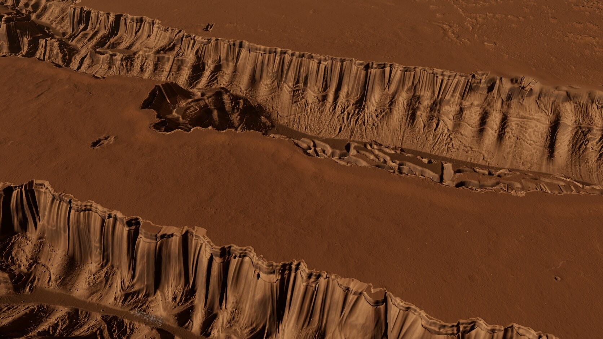
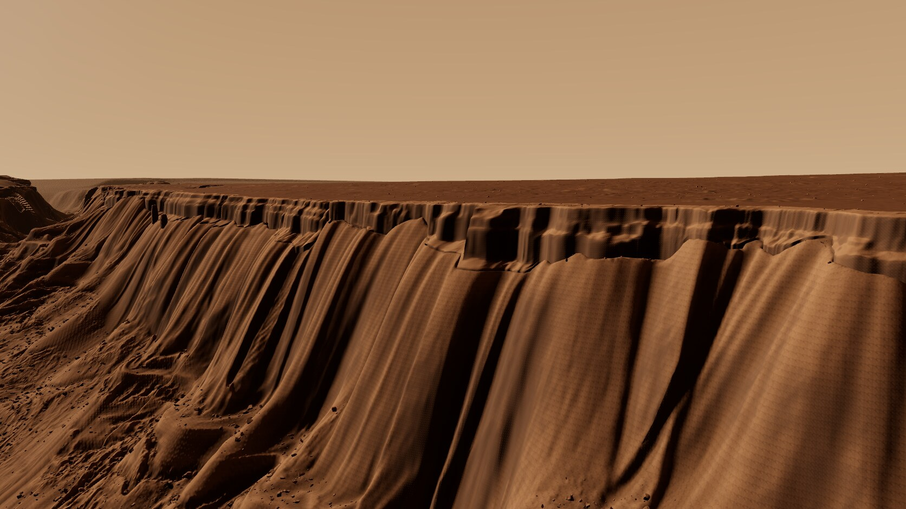
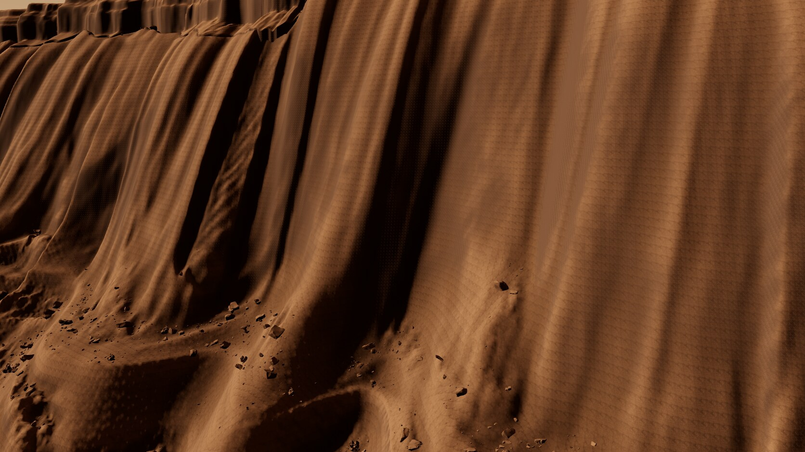
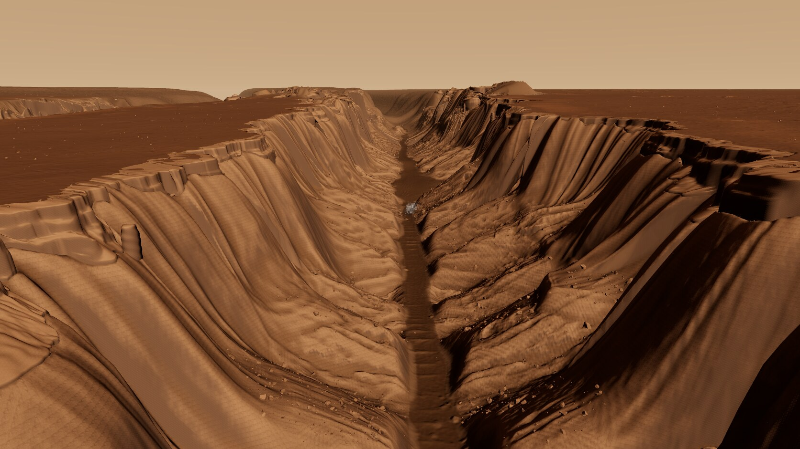
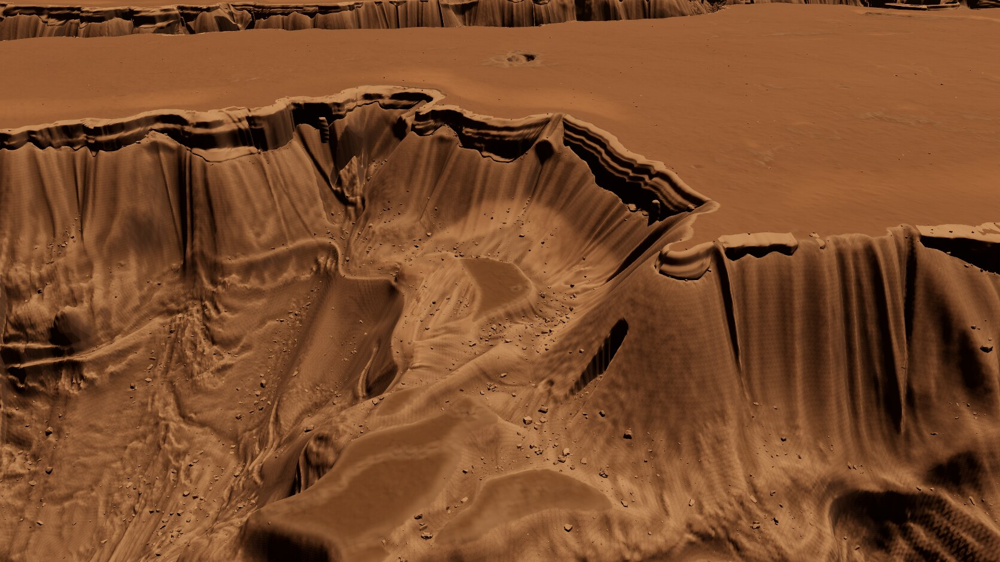
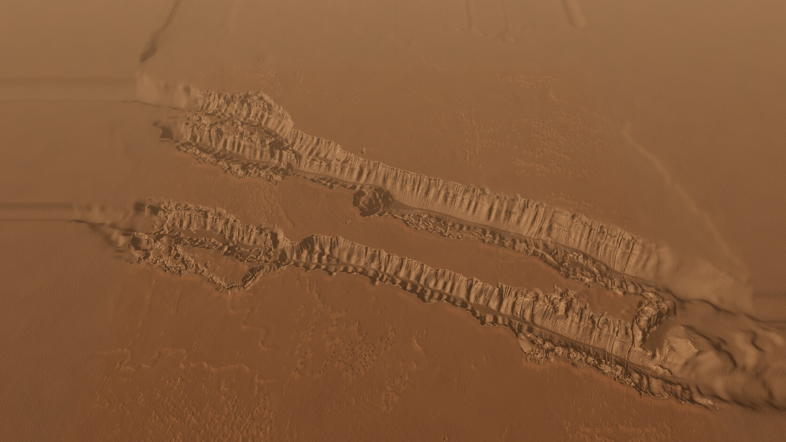

# mm-cerberus, round 3

**Quality: 62% of looks finished. The visual critique remains open.** Three main iterations (046, 048, 052), each baked and captured in all six review cameras. Final scene: 052-r3-i3. Page: [endpoint removed]

## Changes

- Removed procedural bedding/notch relief and separate grey band shading. Default faces use full native-scale Snake River/Malad offset profiles, cropped without height gain; source ledge heights and original along-source coordinates are retained. Missing source columns and reflected placement are explicitly procedural. The top-down 1 m DTM and monotone profile inversion do not recover overhangs or every fracture.
- Added band height variation, recessed alcoves/amphitheatres, collapsed stretches and 88 procedural detached pillars. Repaired false padding shelves, projection holes and old residual needles in the hidden backing/apron; the native face mesh is not smoothed. Curved placement still stretches native metre intervals; rigid patches are prepared for round 4.
- Kīlauea lower-apron relief retains larger measured features (6 m high-pass, gain 1.0), with 263,870 angular scree instances and more large talus blocks. Source polar sampling and procedural placement are credited.
- Deposit coverage follows connected terrain exposure instead of noise-threshold blotches. Clean CTX filtering drops from 32 to 10 m; source resolution remains 20 m. Native Earth face patches now extend to eligible 55 m trough ends.
- Added exact gzip/MMD3 binary packing, individual rock culling, honest counts for context/skirt/trail geometry, trail/apron/pillar batching and parent-first mesh scheduling. Optional old wall GLBs gzip-pack with exact decoded hashes.
- Replaced normal JPEG block compression with per-pixel octahedral RG7 in lossless WebP. Full RGB WebP was 57.79 MB; final compact map is 33.416 MB. Angular error P50/P95/P99/max is 0.4257/0.9264/1.2972/1.8883 degrees. The final RGB comparison (053) shows RG7 still contributes to the visible fine grid; this is not a complete visual fix.

## Critical review

All six images were inspected against HiRISE PSP_007131_1905_RED fossa imagery, the CTX-derived layout hillshade, the credited Malad Gorge photograph and rover PIA24816. The palette integrates better and giant false needles are greatly reduced. Long cloth-like steep walls, shelf seams, a fine normal grid and smooth material between blocks remain plainly visible. Gameplay and fissure still read as continuous tall curtains. The asset and gameplay caps pass; that does not make the scene finished.

- Tall lower walls still read as smooth curtains; native top patches remain draped, with shelf-like seams.
- Fine grid remains on steep lit slopes; the RGB normal probe reduces it relative to RG7, so precision is still visibly inadequate.
- Talus matrix is still too smooth despite the added scree; most large steep surfaces currently exclude scree by slope.
- CTX margins and map edge remain softer than the HiRISE core.
- Deposit noise is removed, but its exposure is subtle and nearby cliff seams remain obvious.

## Performance and assets

1920×1080, RTX 4070 SUPER, Chrome/ANGLE Vulkan, uncapped. Counts include submitted camera-visible terrain skirts, all selected rock instances, native faces/pillars, trails and context. Old round-2 counters omitted groups and are not directly comparable. Render timing is composer/gl.finish; rAF timing is the full app loop. The stale stats.fps sampled during the blocking render benchmark is not used.

| Camera | Terrain | Rocks | Native band | Trails | Context | Total | Render ms | rAF fps |
|---|---:|---:|---:|---:|---:|---:|---:|---:|
| close | 199952 | 166319 | 130049 | 0 | 269452 | 765772 | 2.71 | 275.9 |
| gameplay | 346692 | 105271 | 44873 | 60 | 0 | 496896 | 2.33 | 352.1 |
| overview | 19072 | 0 | 92028 | 0 | 400384 | 511484 | 2.56 | 360.4 |
| wall | 261806 | 167472 | 73024 | 48 | 290700 | 793050 | 2.55 | 307.1 |
| fissure | 515660 | 263416 | 145595 | 6 | 280148 | 1204825 | 2.83 | 243 |
| deposit | 547700 | 233273 | 67057 | 6 | 3584 | 851620 | 2.92 | 302.4 |

Processed assets: **146.86 MB**, including the optional wall variant and excluding export. Default browser assets: **139.87 MB**. Export: 182.46 MB. Stored terrain triangles across all LODs: 5,028,384. Gameplay forced scatter refresh: median 6.1 ms, maximum 9.0 ms; no speculative spatial-index rewrite was needed.

Validation: fifteen focused geometry/codec/normal tests and production build pass; decoded mesh and auxiliary SHA256, indices, normal pixels and PNG/WebP mask equality pass. Export height maximum decode error: 0.01504 m. Band height P10/P50/P90: [13.02, 35.18, 63.07] m; 12673 collapsed eligible columns.

## Export and next round

Existing export filenames retained. Added cliff_faces.json, masks_a.png, masks_c.png and review_round3.json; README.json records codecs, source kinds and all changes. All height/masks/scatter/features were refreshed from the final DEM. Every heavy bake/capture took its own shared flock after the orchestrator corrected the first chain's outer lock. Existing Vite stays on [address removed].

Round 4 should preserve native geometry with rigid patches, reduce the normal grid without block compression, and roughen steep surfaces with explicitly credited embedded scan fragments. This is the first of the two permitted continuation rounds.

