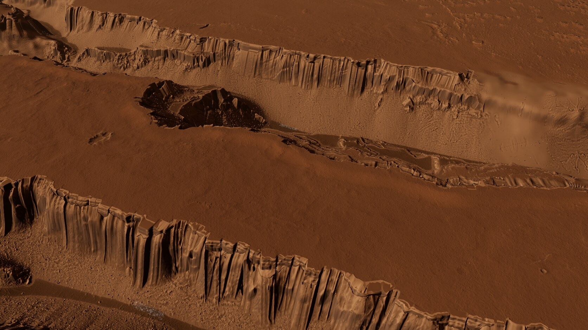
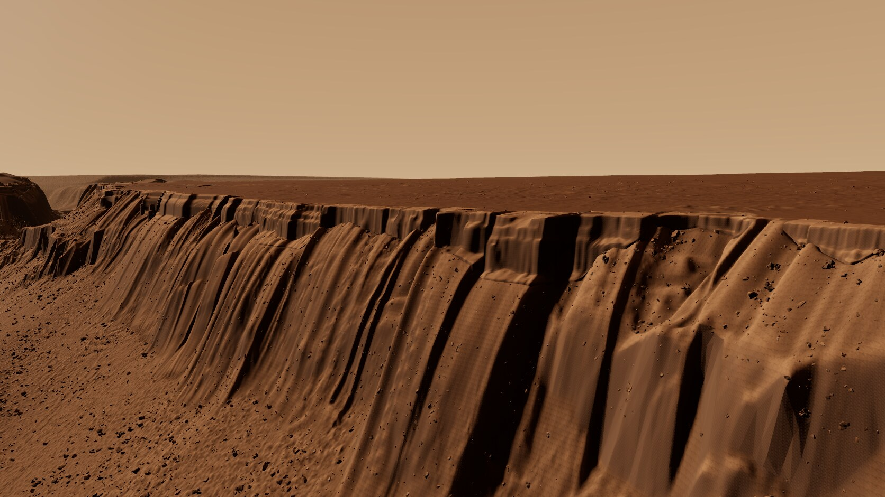
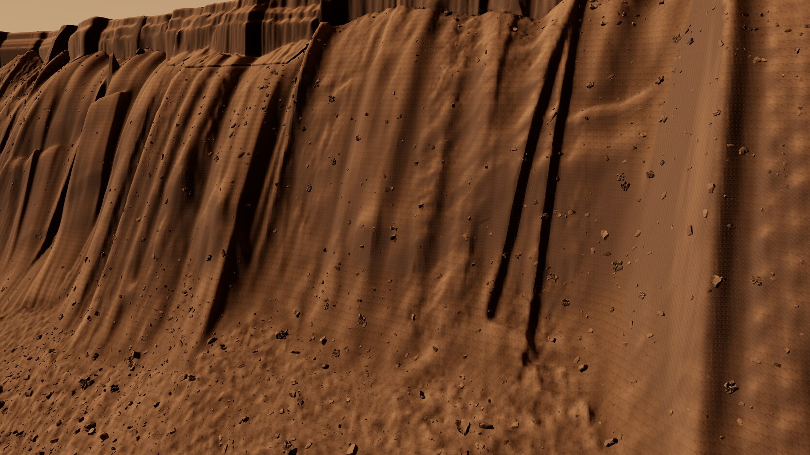
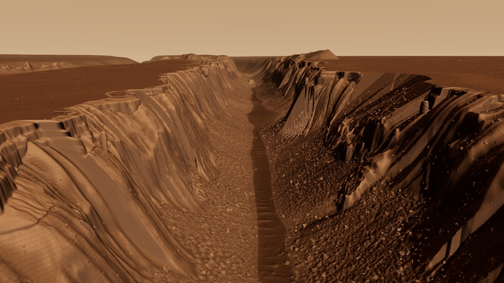
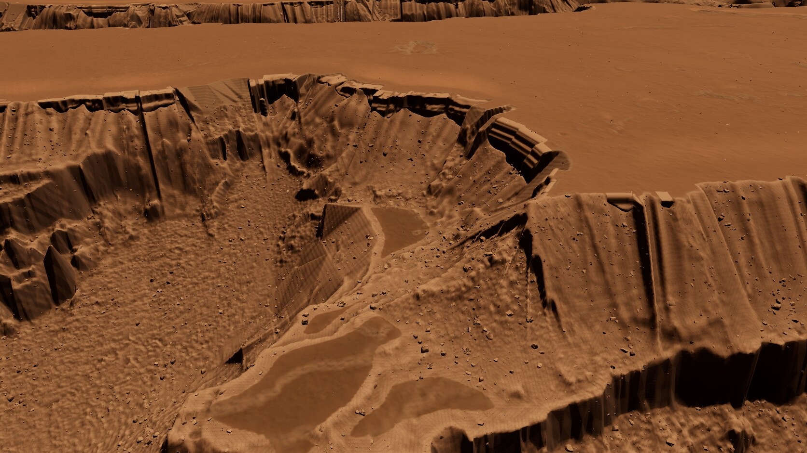
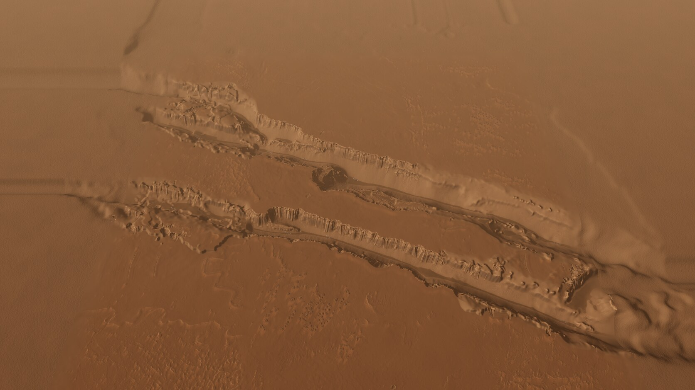

# mm-cerberus, round 4

**Quality: 66% of looks finished. The cliff and CTX critique remains visibly open.** This is the second and final permitted continuation round. Three iterations, with all six cameras inspected for each. Final images: 057-r4-i3. The two-round workflow ends here below the 80% threshold.

Final scene commit: `1a2bf72a1da4a0e2e4bf6a3034416bf1948c3901`.

Page: [endpoint removed] The existing server remains on [address removed].

## Changes and iteration decisions

- Rigid 80 m native Snake/Malad interiors preserve unrolled metre coordinates, with 8 m explicitly procedural pose joins. The curved-placement physical metric regression failed before the fix and passes. Native source height is cropped, never amplified or smoothed. These are top-down 1 m lidar DTM profiles, not raw point-cloud wall scans; monotone inversion cannot recover overhangs or every fracture.
- Alcoves grew from 22 to 45 m, amphitheatre spacing dropped from 900 to 600 m, and collapse threshold increased from .22 to .32. These are authored placement choices, not new scan coverage. Final band height P10/P50/P90 is [11.52, 33.22, 63.39] m, with 7877 collapsed eligible columns and 39 procedural pillars.
- Ray projection previously evaluated a sample's height and assigned it to a different 2 m cell centre. The oblique-plane regression was red (up to 3.7266 m per-sample error); actual cell-centre evaluation now passes. This removes geometric aliasing without smoothing native faces.
- Extended the credited Kīlauea nominal-metre rubble transplant onto steep lower walls, excluding native face coverage. Added 1.5–7 m normal-aligned, partly buried Ramon/AA/PH07 scan fragments. Size, placement and orientation are procedural. Final scatter includes 309,694 angular scree and 101,088 embedded fragments; the matrix still needs work.
- Iteration 1 retained the amplified depth-remapped lower backing. Its 055 captures still showed large curtains, and both budgets failed. Iteration 2 replaces that backing with the Mars base DEM while retaining explicit native face transplants and their authored backing/upper apron. Lower rubble and gameplay layout improve; upper patches and close walls still look draped. No additional wall blur was applied. Mars stereo uncertainty in shadowed walls remains.
- RG8 octahedral normals replace RG7 in lossless WebP. Angular error is measured against unit vectors decoded from the source 8-bit RGB normal image, excluding that initial RGB quantization. Scene metadata records both pixel hashes and precision. The fine grid is reduced in some places but remains visible.
- MFB4 groups float-record field byte planes before gzip, preserving every bit; MMD3 mesh packing remains exact. Retired the boxed, unused optional round-2 GLB payload. Unused texture slots 3/6 keep their layout and 16 px borders; active decoded pixels are identical and their SHA256 values are recorded. These changes save about 9.35 MB before the backing reduction.
- Iteration 3 sets default terrain LOD error to 5.2 px. The measured sweep reduced gameplay from 604,866 to 437,344 triangles. It rebuilt the frontend and repacked the iteration-2 terrain; all nine mesh/auxiliary decoded hashes remain identical. Native face and rock thresholds remain unchanged. Export was refreshed and all six cameras recaptured.

| Iteration | Capture prefix | Quality | Gameplay 1080p tris | Processed MB | Browser MB |
|---|---:|---:|---:|---:|---:|
| 1 | 055 | 64% | 653,835 | 157.92 | 150.94 |
| 2 | 056 | 66% | 604,866 | 126.08 | 126.07 |
| 3 | 057 | 66% | 437,344 | 126.08 | 126.07 |

## Critical review

Every final 057 image was inspected against the local HiRISE fossa-wall ortho/PSP_007131_1905_RED, CTX-derived layout hillshade, credited Malad Gorge photograph and rover PIA24816. Reference photos were not used as textures. Lower scree is substantially rougher, jagged blocks are visible, and the band blends into the brown basalt/dust palette. Gameplay terrain and assets pass their measured limits. The cliff does not look finished.

- Long draped cliff faces still dominate wall and fissure views; native patches have abrupt shelf and triangular joins. Band height variation and collapsed sections do not yet read as finished basalt structure.
- A fine regular grid/dash pattern remains on lit smooth faces despite the pixel-centre projection fix and higher normal precision.
- Lower talus has denser angular scree, but the steep matrix between fragments still reads too smooth and dune-like.
- CTX margins and the HiRISE/context transition remain visibly softer; the original CTX source is 20 m, with transplanted detail explicitly credited.
- The original noise-threshold deposit blotches are gone, but the exposure is subtle and neighbouring shelf seams remain conspicuous.

The native dataset is a top-down DTM and the current face reconstruction has visible limitations. Procedural joins, missing-column continuation, pillars and resized rocks are explicitly credited; none are described as measured Mars detail. CREDITS.md also corrects the older backing's relief gains.

## Performance and validation

1920×1080, RTX 4070 SUPER, Chrome/ANGLE Vulkan, uncapped. Counts include camera-submitted terrain skirts, all selected rock instances, native faces/pillars, trails and context. Other review cameras exceed 500k; the required gameplay camera is **437,344**. The cap is verified at this resolution. Render timing is composer/gl.finish; rAF is the full app loop. Blocking-benchmark stats.fps is stale and omitted.

| Camera | Terrain | Rocks | Native | Trails | Context | Total | Render ms | rAF fps |
|---|---:|---:|---:|---:|---:|---:|---:|---:|
| close | 225606 | 395163 | 120684 | 134 | 269452 | 1011039 | 3.26 | 250.6 |
| gameplay | 223602 | 180925 | 32767 | 50 | 0 | 437344 | 2.34 | 428.1 |
| overview | 47246 | 0 | 38161 | 0 | 400384 | 485791 | 2.09 | 456.6 |
| wall | 268478 | 348065 | 59318 | 72 | 290700 | 966633 | 2.62 | 275.3 |
| fissure | 271336 | 618499 | 73076 | 1340 | 280148 | 1244399 | 2.91 | 225.4 |
| deposit | 329694 | 473456 | 42295 | 640 | 3584 | 849669 | 3.46 | 292.5 |

Processed assets: **126.08 MB**; default browser assets: **126.07 MB**, decimal MB, excluding export-only copies. Stored terrain triangles across all LODs: **3,118,146**. The retired optional payload is no longer shipped.

Nineteen focused geometry/rotation/codec/normal tests and the final production build pass. Full-file decoded mesh/auxiliary hashes, index bounds, native face layout, active texture hashes, normal pixels and PNG/WebP mask equality pass. Export height maximum error is **0.01504 m**. All final camera error lists are empty. Native face columns: 27473; mesh nodes: 809.

## Export and stopping state

Height, material/gameplay masks, scatter, features and cliff_faces.json refreshed. Added review_round4.json and six review_round4/*.jpg files; every existing export filename is retained, including review_round3.json. README.json records source kinds, codecs, changes and the unresolved critique. Each heavy bake, packing/export step and capture run took its own [path removed]; no whole-chain lock. No other session's process was killed.

Round 3 was committed as e83a320. Round 4 is closed at 66% and committed on mm/mm-cerberus; STATUS.txt records the final scene commit and remaining issues. No third continuation round is authorized in this run.

