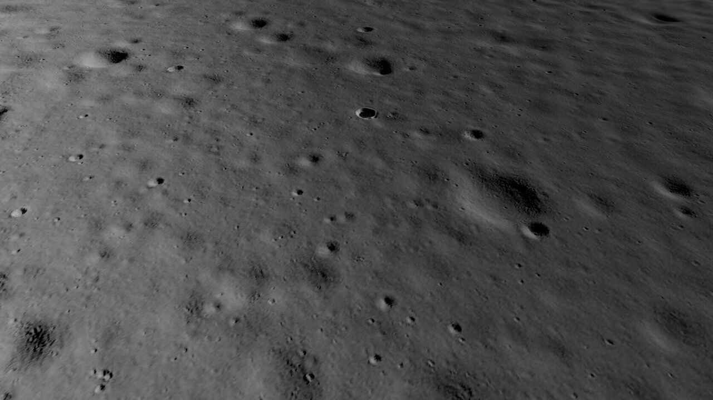
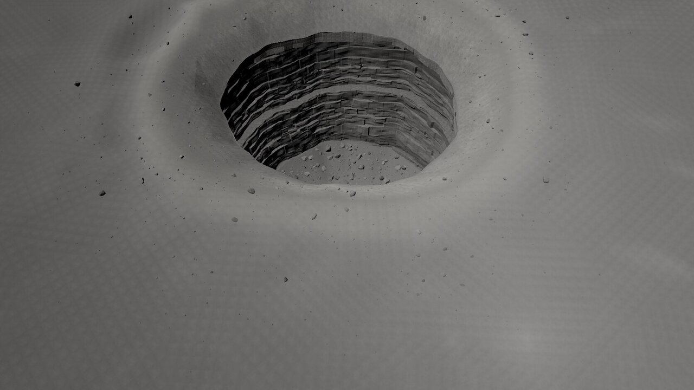
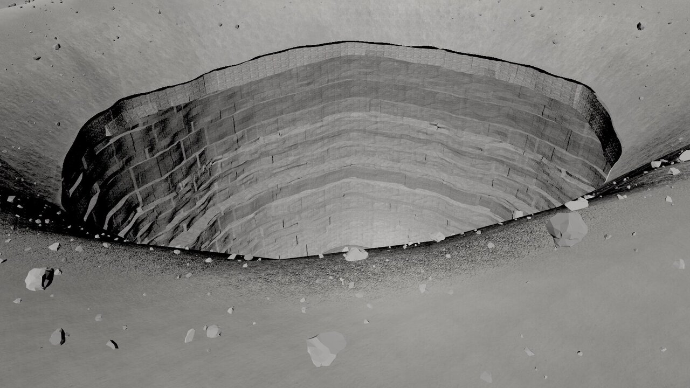
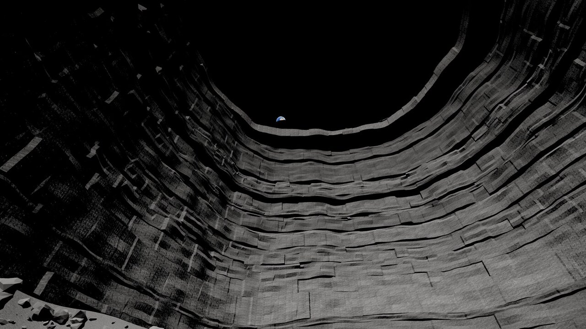
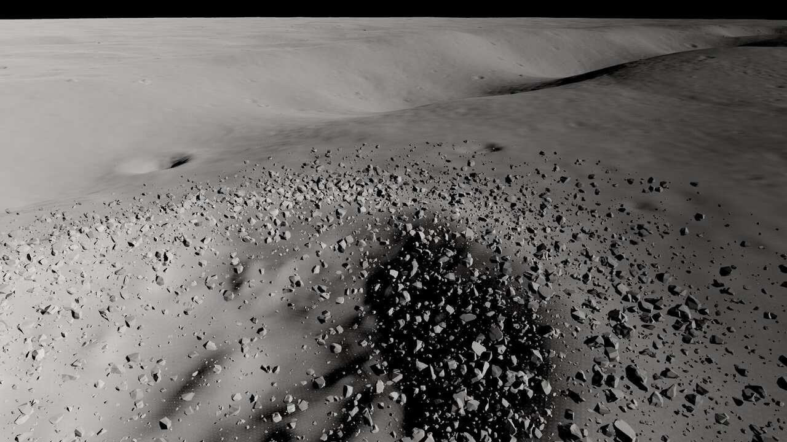
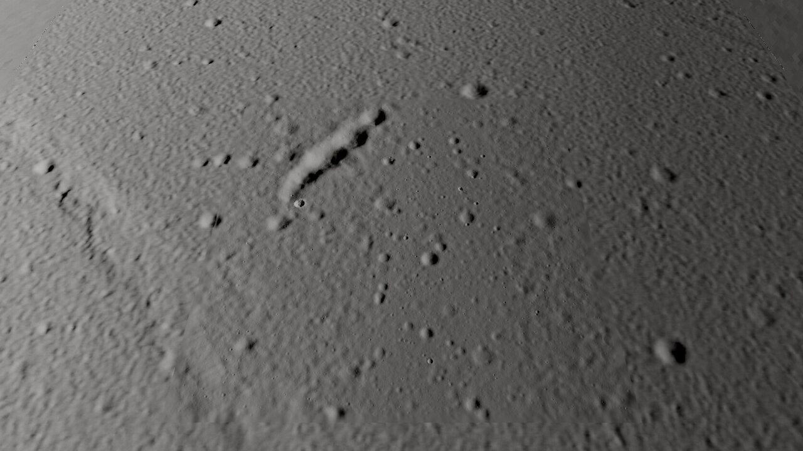

# mm-tranq (Mare Tranquillitatis pit, `moon.mare_tranquillitatis`), round 1

Page: **[endpoint removed] (branch `[path removed]`). Details per iteration: [LOG.md](LOG.md); sources: [CREDITS.md](CREDITS.md).

Final captures: `[path removed]` (10 iterations, `001`-`014`).

## What was built
- **Base (real):** Kaguya TC DTM 8.4 m for everything above ~150 m wavelength over the 12 km map and the ±16 km context ring; the LROC NAC **TRANQPIT1 2 m strip pasted at its true position** (x = -1.2 .. +3.5 km, full N-S; plane-registered, -1.3 m median, 300 m feathers). Below 150 m, the Kaguya part carries real TRANQPIT1 2 m relief transplanted from other parts of the 28 km strip (Kaguya alone is orange-peel stereo noise at that scale). SLDEM2015 (250 m) for the ±64 km skyline, dropped by the Moon's curvature. The real doublet crater and the real wrinkle ridge (W of the map, in the context ring) are visible in the overview.
- **Pit (authored to measurements):** funnel 143 m / 20 m deep (steep caprock lip, ~36 deg mean), lip ellipse 100 x 88 m, terrain cut exactly at the lip in the shader (and in the shadow pass), a separate shaft mesh: caprock face, overhang ceiling (12 m N, 13 m E, 11 m W, 2 m S), 36 stacked basalt beds (1.5-7.5 m, setbacks, blocky joints, crisp horizontal steps), recess band 40 m below the lip (3.5 m inset), floor 105 m below the lip sloping 7 m down under the E wall, 14 m talus apron, ~2300 floor blocks. The floor is sunlit in the pit hero (10.4 h) and visible from the funnel.
- **Craters:** West crater (Apollo 11 NAC DTM, x1.8 -> 342 m, ~54 m deep) at the game's fresh-crater spot with the steep-access **ilmenite basalt deposit** on its NE inner rim / upper wall; 320 stamps of the 46 freshest real small craters (8-56 m) from TRANQPIT1 in the Kaguya part; Fecunditatis ridge crest along the real ridge in the SW corner (subtle, like the real one).
- **Halos/rays:** from 1327 craters *detected on the final DEM* (freshness = depth/diameter + rim): continuous ejecta to ~1.4 R, then narrow, beaded rays (30-60 for the pit and West crater). Procedural, labelled as such.
- **Rocks:** 6 Apollo sample scans (10017, 10022, 70017, 15016 for mare basalt; 14321, 60025 for jagged accents) + 6 Poly Haven moon rocks, baked to 2k tris with 512 px colour/normal; 108k instances: pit floor + funnel, fresh-crater rims (densest at the West crater and the pit), ridge crest, very sparse open mare.
- **Look:** grey regolith from luminance-only regolith scans with a high-Ti mare tint (albedo ~0.10), immature ejecta +80 %; lunar-Lambert photometry (McEwen limb term, softened phase curve, opposition surge; toggle in the panel); hard sun (PCF, no soft kernel), CSM shadows; regolith bounce fill; auto exposure by sun elevation; ACES. Earth (Solar System Scope, CC BY) at its real direction (az 257.6, el 55.9 - *WSW*, not zenith-east as the brief said: from 33 E the Earth is toward 0 E), lit by the sun so its phase follows the time slider (5.6-18.4 h local solar time). Faint stars only with the sun down.

## Bake pipeline (`[path removed]`)
prep (`prep_base.py`) -> kitbash (`kitbash.py` + `kitbash.json`) -> horizon -> mesh (error-bounded quadtree, 2 m leaves) -> rocks (`bake_rock_glbs.sh` / `blender_rocks.py`, `bake_rocks.py`) -> maps (`bake_pit.py`, `bake_maps.py` + `scene_config.json`) -> apron -> pit -> scatter -> textures -> export. Work data in `[path removed]`. Heavy steps under `flock [path removed]`.

## Triangles and frame rate (1920 x 1080, RTX 4070 SUPER, ANGLE/Vulkan; `perf.mjs`)
| Camera | Terrain | Pit | Context ring | Rocks (instances) | Total | GPU ms / rAF fps |
| --- | --- | --- | --- | --- | --- | --- |
| close (West crater, 350 m) | 146 k | 0 | 144 k | 492 k (11 979) | **781 k** | 1.8 / 389 |
| **gameplay 2350 m / 40 deg** | 147 k | 22 k | 80 k | 59 k (1 484) | **309 k** | 0.9 / 649 |
| overview | 30 k | 22 k | 304 k | 39 k (982) | 395 k | 1.0 / 691 |
| pit wall hero | 11 k | 220 k | 29 k | 59 k (1 351) | 319 k | 2.2 / 382 |
| pit hero (sunlit floor) | 17 k | 220 k | 0 | 108 k (2 708) | 345 k | 1.5 / 545 |
| Earth through the skylight | 22 k | 220 k | 7 k | 23 k (517) | 272 k | 1.4 / 520 |

Assets: 115 MB in `[path removed]` including the 46 MB export.

## Export (`[path removed]`)
Same layout as the Io exports: `[path removed]` (6000², 16-bit, pit floor inside the lip), `material_4m.png` (immaturity, blocky, cliff, ilmenite deposit), `features.json` (pit with lip radius at 256 azimuths, overhangs, recess, floor; West crater + deposit; ridge; 300+ fresh craters; Earth; landmarks; cameras), `scatter.json`, plus **`pit.glb`** (the shaft mesh, new for the importer). Differences from Io: 2 m raster, pit mesh + lip table, no lava/plume files.

## Known problems
- **Gameplay rock count is ~1 500, not ~6 000.** At 2.35 km a rock must be >~1 m to cover half a pixel; the open mare is (really) almost boulder-free and the gameplay frame does not include the West crater. More would mean inventing boulder fields or counting sub-pixel instances.
- Gameplay view reads a bit soft: terrain is 2 m data, the mare is flat; the long shadows (6.9 h, sun 13 deg) carry the relief.
- Pit walls: bed pattern is regular (same bed sequence all around, blocks a bit rectangular, texture stretching on some faces); no Leidarendi / basalt-canyon *mesh* scans were kit-bashed (only the basalt-cliff scan textures). The talus apron is a smooth ramp under the blocks.
- The West crater's cast shadow looks blotchy at the close camera (its real blocky interior at 1.8x); the crater bowl reads weakly under the lunar photometry at that angle.
- Halos are subtle at gameplay; rays read as spokes from directly above at high sun.
- The Fecunditatis ridge stamp is barely visible (the real ridge is subdued and mostly outside the map).
- Pers Scans boulder-field patch and the Ingenii satellite pit were not used.
- Earth is a flat day map (no clouds layer / night lights); its axis orientation is approximate.

## Next steps
Real wall kit-bash from the Io basalt-canyon / lava-tube meshes, per-azimuth bed variation and talus cones under the overhangs; a rubble-patch decal; a gameplay frame (or a second gameplay camera) that includes a fresh blocky crater; brighter halo contrast tuned against the NAC photos (M155016845R); the ridge stamp in the context ring too.

Honest estimate: about **65 %** of "looks finished": the pit (cut, overhang, layered walls, sunlit floor, Earth through the skylight) and the real-data base are solid; the gameplay frame and the boulder density are the weak part.
