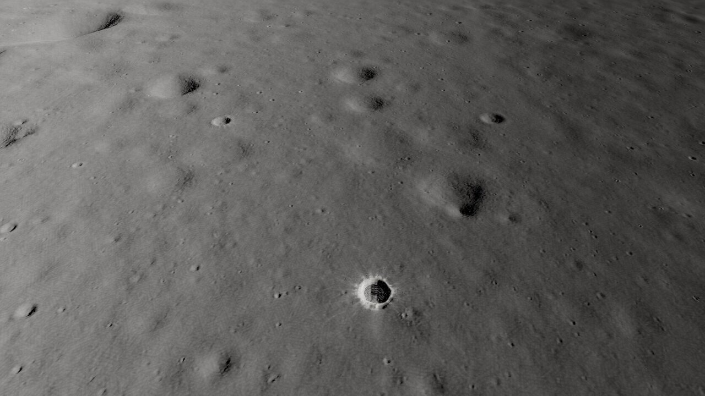
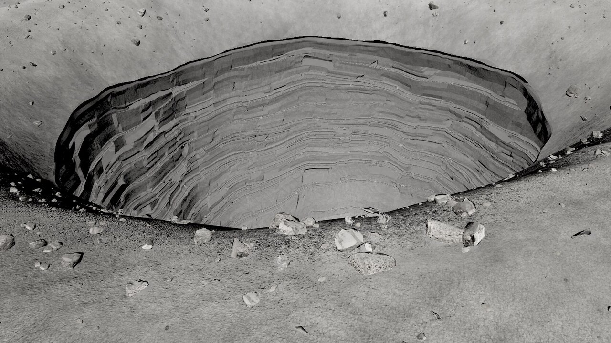
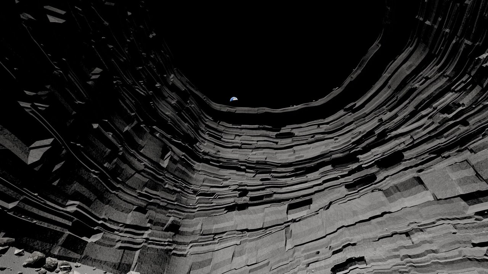
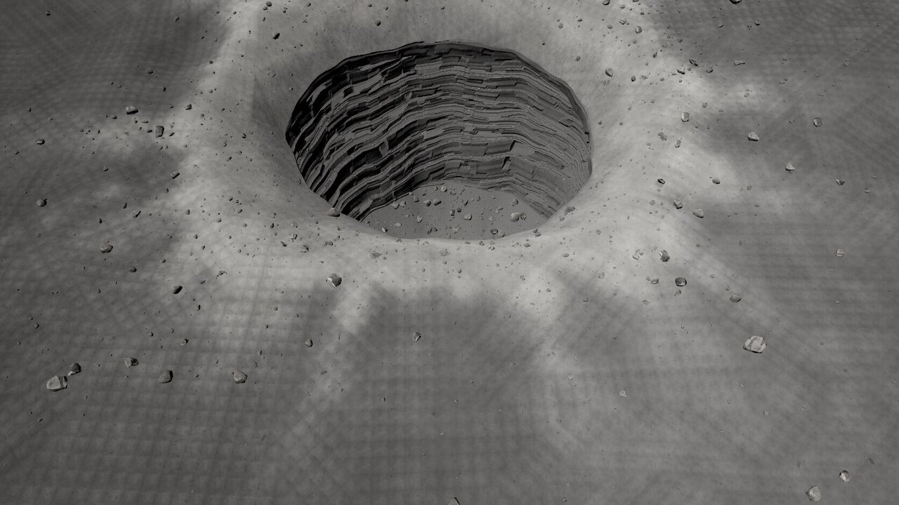
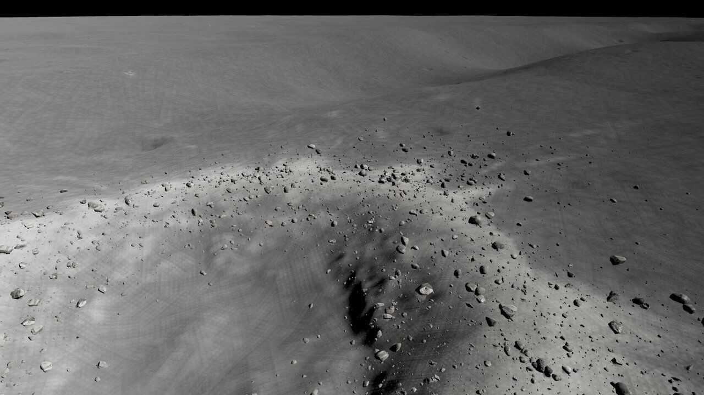

# mm-tranq round 2

Page: **[endpoint removed] Round 1: [ROUND-1.md](ROUND-1.md); iterations: [LOG.md](LOG.md) (r2-01 .. r2-07, 8 capture runs).

Final captures: `[path removed]`.

## By review point
1. **Pit walls.** New generator (`bake_pit.py`): 47 mare-basalt units with base thickness 1-8 m whose thickness varies around the shaft (some pinch out over part of the circumference); joints are irregular cells of 2-14 m that wander with depth, faces spalled unevenly, ~12 % spalled alcoves (deepest mid-bed); where a unit protrudes there is a ledge with a talus wedge against the face above, regolith-dusted in the shader (plus ~3 600 rubble blocks on the ledges); a 1-2 m fine regolith cap over a darker, rough caprock lip; rough ceiling under the overhang. All triplanar projections anti-tiled. Faces stay crisp (flat geometric normals). Still somewhat banded in the wall-hero view (the beds are continuous sheets, as in the NAC images, but read more regular than M144395745L).
2. **Regolith.** Mare albedo 0.075 (high-Ti), the real regolith scans at 3, 13, 27 and 53 m tiles (the cratered scan gives micro-craters at every range), contrast x1.6, stronger close-range normals; fresh ejecta x2.25 and blocky (bright clasts from the rubble scan). The funnel halo is now a blocky, ray-broken apron with ~1 400 ejecta blocks.
3. **Rocks.** The kit's 6 Apollo scans with their own textured LOD0/1/2 + a 24-tri LOD3, graded to regolith grey; Poly Haven rubble with textured LODs; 18-30 % buried, each with a dithered regolith fillet; power-law sizes everywhere.
4. **West crater block field.** Ejecta model: densest on the rim crest and upper inner wall, radial fall-off (e-folding 0.45 R), 14 ray-aligned clusters, a few 5-10 m blocks; small/far rocks cast no shadow and the close camera moved to 8.4 h, which removed the dark carpet (a narrow real shadow of the blocky interior remains).
5. **Gameplay frame.** 2 350 m / 40 deg, looking north with the pit in the lower third, side light at 7.2 h: the pit with its rayed halo and a row of fresh craters with blocks. The West crater cannot share the frame with the pit at this camera: they are 5.4 km apart and the 40 deg frame sees ground from 0.7 to 5.6 km (tested along the pit -> crater line: flat-lit or back-lit, and the crater fell just beyond the top edge). 2 093 rocks rendered at gameplay (r1: ~1 200).
6. **Budget.** Gameplay 272k triangles.

## Triangles (1672 x 941 capture, RTX 4070 SUPER)
| Camera | Total | Rocks rendered |
| --- | --- | --- |
| **gameplay** | **272 k** | 2 093 |
| close | 761 k | 4 584 |
| overview | 370 k | 106 |
| wall hero | 874 k | 3 562 |
| pit hero | 576 k | 4 821 |
| Earth through the skylight | 808 k | 2 546 |
The pit hero, wall and Earth views are over 500k (pit LOD0 307k + near rocks); only gameplay is budgeted.

## Export
Refreshed, nothing renamed; `README.json` -> `changes.round2` lists the changes (rock LOD format: GLB nodes + `lod3` .bin instead of the r1 `lod1`/`lod2` .bin; new pit mesh with kinds 5-7; regenerated halo masks; re-aimed views).

## Known problems
- Halos of small fresh craters are still faint at the gameplay range (few craters are fresh on this mature mare; the 4 m mask limits them).
- Wall hero still reads banded; joint cells can look boxy up close; no wall-module scans kit-bashed.
- A faint regular grid is visible in the regolith at the pit-hero distance (large-tile texture/anti-tiling interaction).
- Close-up views exceed 500k triangles.

Estimate: ~72 % of "looks finished" (r1: 65 %).
