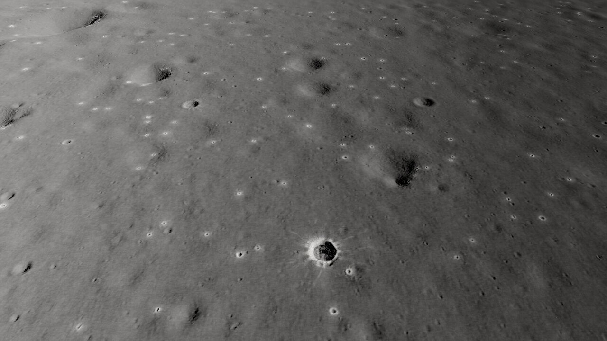
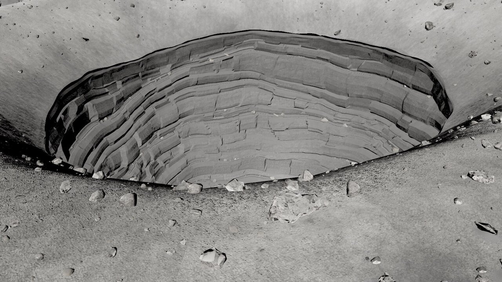
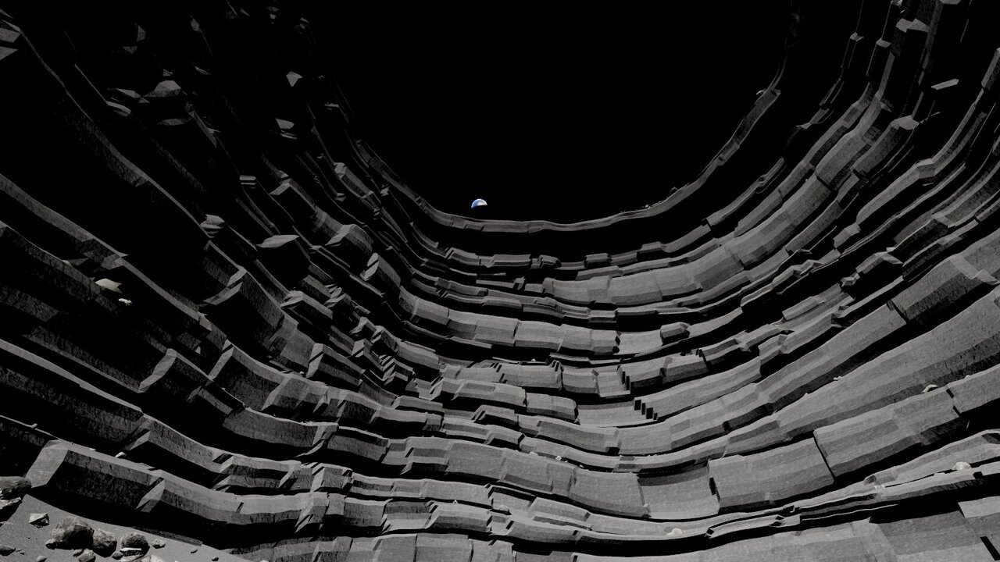
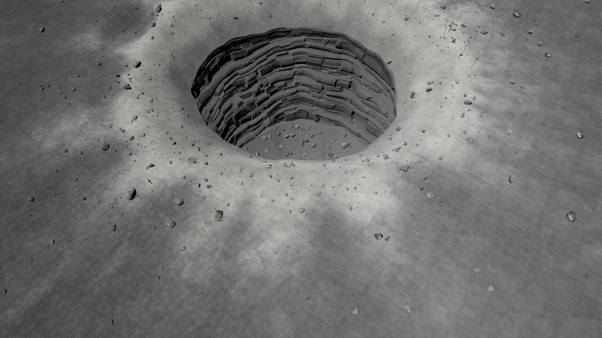
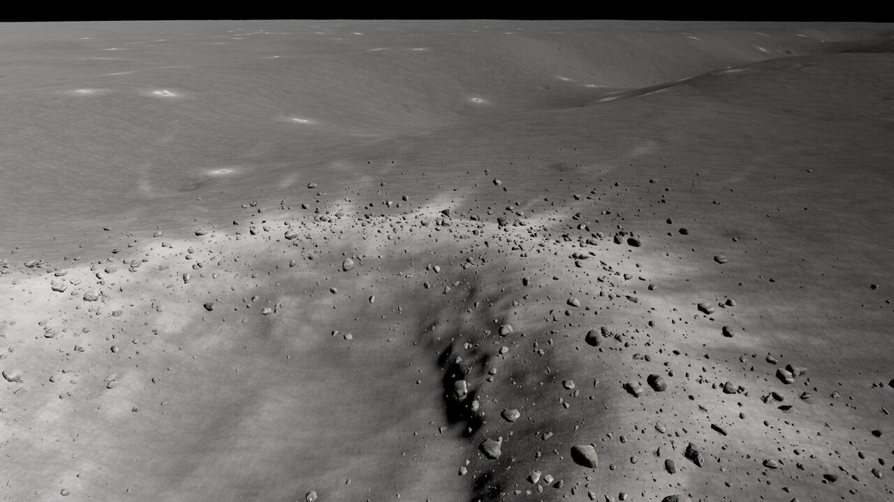

# mm-tranq round 3

Page: **[endpoint removed] Earlier: [ROUND-1.md](ROUND-1.md), [ROUND-2.md](ROUND-2.md); iterations: [LOG.md](LOG.md) (r3-01 .. r3-05).

Final captures: `[path removed]`.

## By review point
1. **Swirl / grid in the regolith:** the rotated two-sample anti-tiling is replaced by hex-tile blending (Mikkelsen 2022 style: triangle grid, a random translation per grid vertex, no rotation, sharpened barycentric weights with a luminance term), on every triplanar projection of every material. Detail normals fade with distance per scale. No cell seams or rosettes in the close, gameplay or pit views.
2. **Pit walls:** 23 massive mare-basalt units of 2.5-14 m (was 47 thin ones); each unit has rounded / spalled top and bottom edges whose depth varies along the wall, a convex bulge, stronger setbacks and joint relief; ledges carry rubble and slumped blocks up to 4 m. The contour-line look is gone; faces stay crisp.
3. **Small crater halos:** immature ejecta 1.5-2.5x the mare albedo with a 16 m minimum apron and blocky rims for craters under 40 m (no rays at that size: they turned into star sprites), down to freshness 0.08. The gameplay frame now has the LROC-like speckle of bright rims and dark floors.
4. **Triangles:** pit mid LOD + rock LOD distances. Only the gameplay view is budgeted (500k).

| Camera | r2 | r3 |
| --- | --- | --- |
| **gameplay** | 272 k | **246 k** (2 138 rocks) |
| close | 761 k | 769 k |
| overview | 370 k | 343 k |
| wall hero | 874 k | 743 k |
| pit hero | 576 k | 498 k |
| Earth through the skylight | 808 k | 656 k |

## Export
Refreshed, nothing renamed; new `[path removed]`; `README.json` -> `changes.round3`.

## Known problems
- The close camera stays at ~770k (4 600 rocks + the 50 m context-ring tiles near the West crater); the wall and Earth views ~650-750k because the pit LOD0 (219k) is in view with near rocks.
- Small halos are similar in size; a size spread would read more natural.
- The wall still has no scanned wall-module geometry (shapes are authored to the measurements; textures are real basalt scans).

Estimate: ~76 % of "looks finished" (r2: 72 %).
