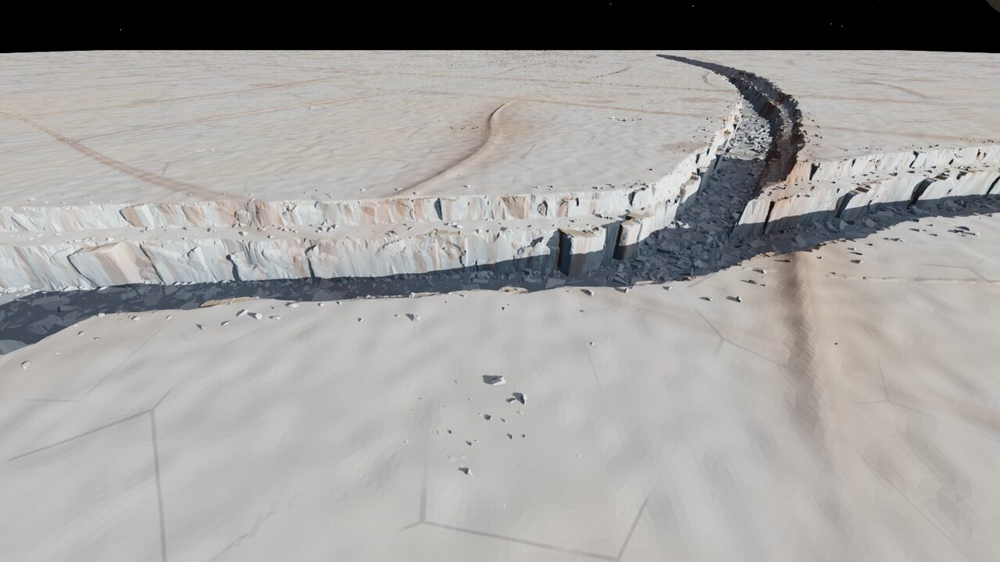
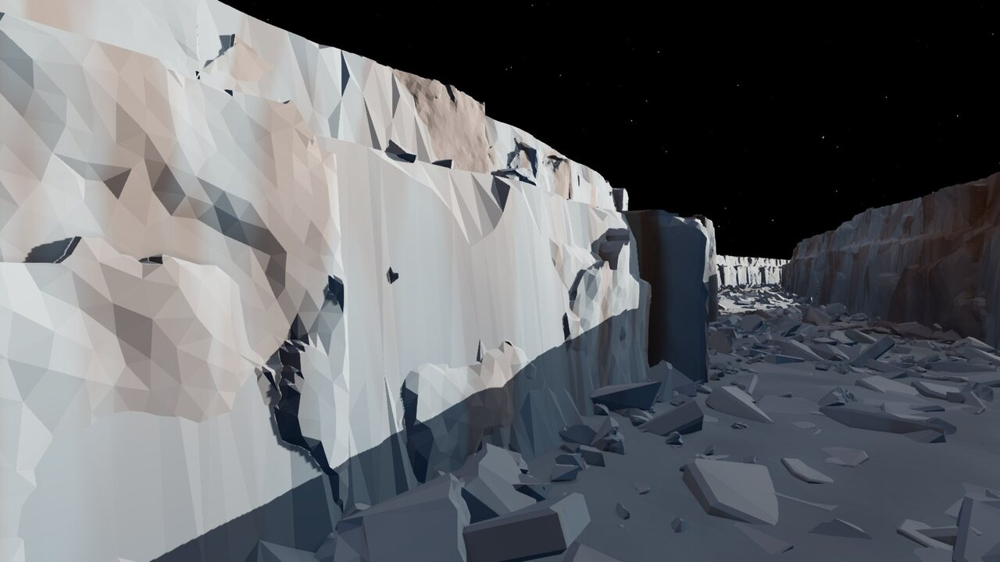
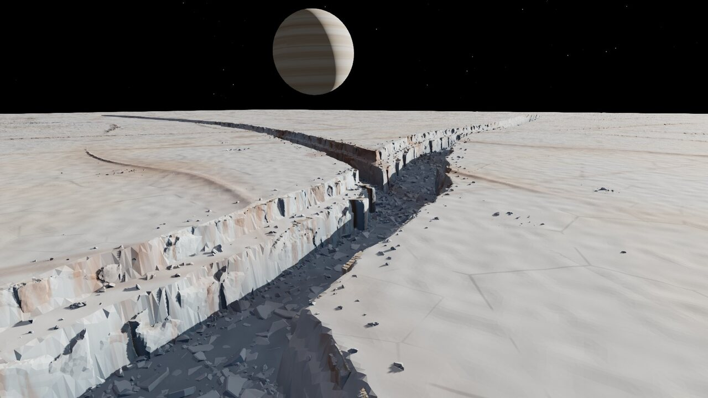

# Scene A, round 1: ice rift canyon

Page: `rift-a.html`. Run `npm run dev` and open `/rift-a.html`; the buttons switch between the gameplay, close-up and hero cameras. Use `?view=game|close|hero` to pick a camera and `&capture` for a bare canvas. The code is in `[path removed]`, the processed assets (528 KB) in `[path removed]` and the processing scripts in `[path removed]`.

Progression from it01 to it05 to it12 (rows: game, close, hero): [shots/progression.jpg](shots/progression.jpg). The iteration log is in [LOG.md](LOG.md) and the sources in [CREDITS.md](CREDITS.md).

## What was built
The map is a 2.2 km square game area, with ground continuing to 6 km for the horizon. A branching rift runs through it: a trunk 80 m deep and ~280 m rim to rim, crossing the gameplay view. A north-east branch splits off at ~35°, and a side fissure tapers out toward the camera-left foreground.

The north wall, which is sun-lit and faces the camera, has the Charon single-wall bench at 0.36 of the depth. The other wall has only a narrow ledge. Both walls are built from real calving-front ice scans. The floor holds broken slabs, and the wall foot, bench and rim carry talus of scan-derived ice blocks.

The plateau shows Europa-style lineae: an analytic triple band with a low ridge swell, the same function used for relief on the CPU and colour on the GPU, so the bands continue down the rift walls. It also has a sparse polygonal crack net, faint lenticulae mottling, and clustered block fields. The sky is black, with stars and Jupiter at about 11.5° across. The sun is low (16°) and hard; fill comes only from a faint warm Jupiter shine plus a cool ice-bounce hemisphere light.

### Scan-derived vs procedural
| Element | Source |
| --- | --- |
| Wall face form: serac columns, crevasse slots, undercuts, top silhouette | **Scan.** Hornsund TLS 2023, Hansbreen front, 8 modules of 72 m each |
| Salt staining in wall joints and recesses | **Scan-derived.** Cavity of the TLS relief |
| Ice blocks (talus, bench, rim, plateau fields) | **Scan-derived.** Qeqertarsuaq iceberg UAV mesh, 12 chunks. Each has one side of real iceberg surface; the planar fracture faces are procedural cuts. |
| Rift cross-section rhythm: one-sided bench, steep walls, raised flanks, branching | **Measured** from the Charon DEM, then scaled and exaggerated. Not 1:1. |
| Branch polylines, wall meander, heightfield, plateau relief | Procedural |
| Floor slabs (broken plates) | Procedural (extruded jittered polygons) |
| Lineae, cracks, lenticulae, palette, Jupiter, stars | Procedural |
| Module placement, scaling, mirroring, instancing | Procedural |

## Pipeline
1. **Scan to mesh** (`tls_modules.py`). Read the LAS (laspy) and fit the calving-front line. Transform to front-plane coordinates (u along the front, v height above water, w out of the face). Rasterise a 0.5 m range image, keeping the outermost return per cell, which is what the scanner saw. The top silhouette comes from the column tops, with sky cells left empty. Fill holes by nearest neighbour, apply a 3×3 median, and soft-bound the relief with 11·tanh(w/11). Cut 72 m modules and taper their ends 6 m back. Close each sheet into a solid slab (back plane, top cap, sides, base).
2. **Decimate:** isotropic remesh at 2 m edges, then quadric edge collapse with planar quadrics to 2,600 faces. This gives even, crisp facets at the studio density. Export a binary `.bin` (float32 positions, uint32 indices) plus a `_cav.bin` cavity array.
3. **Mesh to blocks** (`iceberg_chunks.py`). Decimate the iceberg OBJ, run screened Poisson, repair and close holes into a watertight hull. Intersect it with random convex cells, each seeded on the real upper surface, then decimate each chunk to 110–300 faces.
4. **Layout** (`charon_profile.py` → `layout.js`). The measured Charon profile becomes a parametric cross-section along the branch polylines, with an independent meander per wall. Wall slots sit at the lower- and upper-wall mid-lines every 38–48 m.
5. **Placement** (`main.js`). Each slot gets a random module, or its mirror image. It is scaled so the module spans floor to bench or bench to rim, oriented to the rift centre, and rejected if the rift side is not open or the back is not solid along its whole width. Instanced as 16 InstancedMeshes. Scatter is cluster-first: dense talus at the wall foot, debris on the bench, calved pieces at the rim, a slab carpet on the floor, and block fields on the plateau. All instanced.
6. **Material** (`materials.js`). One flat-shaded, opaque MeshStandardMaterial patch for ground, walls and blocks: blue-white to cream ice, bluer on steep faces, rust lineae and salt streaks, darker blue-grey ice with depth, frost on ledges. Rendering uses the studio `Stage` (GTAO, FXAA) unmodified.

Budget at the gameplay camera: 77 draw calls. Scene geometry is 0.55 M triangles of ground, 1.65 M of walls (633 module instances) and 1.38 M of scatter. Build time is ~1.4 s. The frame time measured in headless Chrome is not reliable, so it is not reported.

## What works
- **Wall form at every camera.** The scan modules read as a real calving front: columns, slots, a jagged lip. They decimate cleanly into the studio's faceted language, and mirroring plus scaling hides the repetition of only 8 modules at the gameplay and hero cameras.
- **Gameplay readability.** Pale plateau, a bright sun-lit far wall with two tiers, and a dark blue rift floor. The rift is the focal band, and there is open plateau in the foreground for building.
- **Hero.** The trunk with bench tiers, the NE branch and Jupiter make a strong Europa image.
- **Consistent lineae.** Ground and walls agree because the analytic band function is evaluated identically on the CPU and the GPU.

## What doesn't (yet)
- **Close-up surface.** Between the big forms, the scan has been smoothed (0.5 m grid, median, ~1 km scan range), so large planar areas look a little plain at 30–60 m. Some long decimation slivers remain.
- **Module seams.** Where the wall bends, a module end or a proud serac can show as a dark flat slab. There is no wall-to-module blend; each module is a rigid slab.
- **Floor at gameplay.** The floor reads as one dark band; individual slabs are lost in the wall shadow. A brighter floor would conflict with the "darker ice inside fissures" requirement.
- **Branch junctions.** The heightfield handles them, but modules are skipped there, so junction walls are plain heightfield.
- **No traversal design.** There are no ramps or passable floors yet, unlike scene C.
- **Triangle count.** About 3.6 M triangles in total. Wall modules need LODs; something like 600 / 150-face levels would be enough beyond 400 m.
- **Raised flanks** (Charon upwarp, 9 m) are barely visible at the low sun.
- **Unused sources.** Dickson iceberg failed to close. The second Hornsund scan was not needed.

## Proposed route into Godot
1. Export the 8 wall modules and 12 ice chunks as GLB, with the flat-shaded normals baked and cavity stored as vertex colour. Add 2 LODs each with the same pymeshlab decimation. Keep the pipeline scripts as the asset build.
2. The rift heightfield goes into the existing terrain path as a baked height map from `layout.js` (or a port of `section()`), with the branch polylines as authored data.
3. Place the modules with a MultiMeshInstance3D per module (+mirror) from a placement pass that runs the same slot rules (open front, solid back). The scatter can share the existing rock scatter system with these chunk meshes.
4. Port the ice shader as one opaque spatial shader: analytic lineae (port `r_lineae` verbatim), slope blue, depth tint, cavity from COLOR, no transparency. It matches the cheap, opaque direction of the Europa ice research note.
5. Lighting: one low directional sun, a dim warm fill from the Jupiter direction, and an ambient blue term; Jupiter as a sky-sphere mesh.
