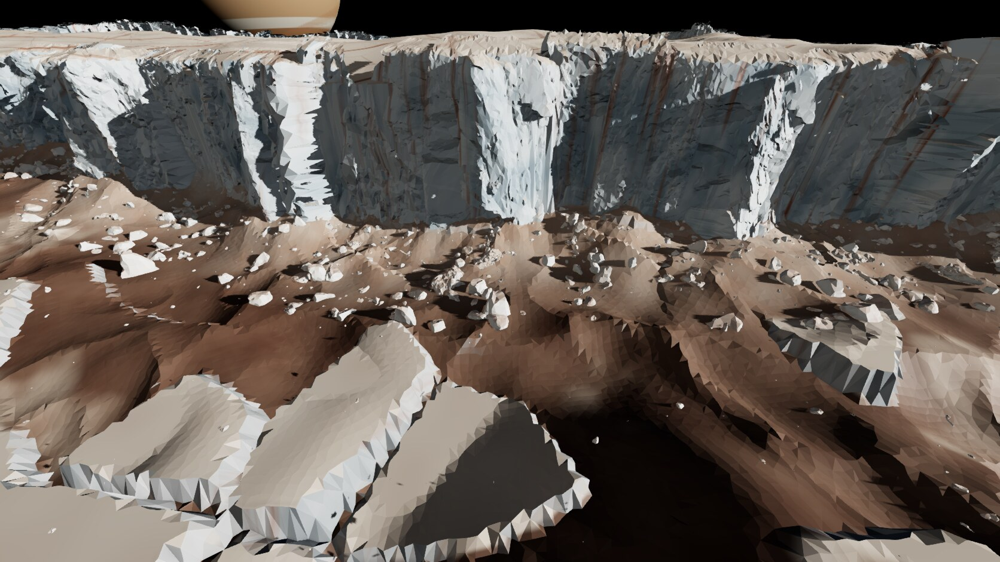
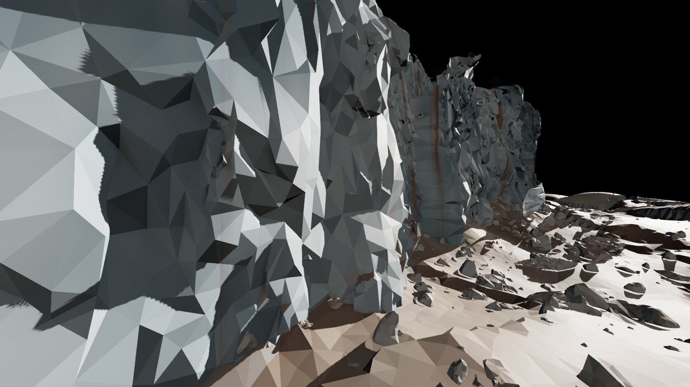
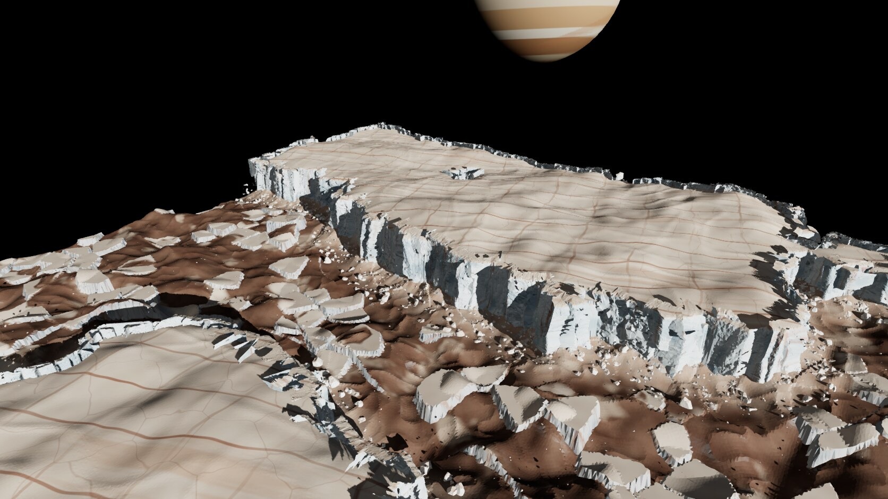

# Scene B, round 1: fault scarp + chaos edge

Page: `rift-b.html`. Run `npm run dev` and open `/rift-b.html`; the buttons switch between the Gameplay, Close-up and Hero views. To reproduce the captures, run `[path removed]`, which uses port [removed].

The scene is a 2.04 km map of a raised Conamara plateau. Its layout and plate heights come from the real DLR stereo DTM. The plateau breaks along a jointed ice scarp, 108–134 m tall in the gameplay view, with a talus apron, toppled blocks and a chaos matrix of rafts in front of it.

## Screenshots
| Gameplay (final) | Close-up (iteration 11) | Hero (final) |
|---|---|---|
|  |  |  |

Progression: [i01 gameplay](shots/001-i01-game.jpg) → [i09 gameplay](shots/009-i09-game.jpg) → [i15 gameplay](shots/015-i15-game.jpg). The final-state close-up is [i15 close-up](shots/015-i15-close.jpg).

## What is scan-derived and what is procedural
**From real data**
- **DTM (DLR Conamara, CC BY 4.0):**
  - The plate outlines (the plan shape of the scarp line).
  - Two plate heights, 129 m and 152 m above the matrix.
  - The real trough relief (0–89 m), and 35 % of the real relief on the plate tops.
- **Scans:** every wall module (6 San Gabriel windows, 1 Mirror Fault, 2 Poly Haven rock faces), every toppled block (Poly Haven namaqualand cliffs and boulder_01), and every debris rock (Poly Haven moon_rock_01…07, namaqualand_boulders_01, stone_01). All of them are decimated and re-materialled.

**Procedural**
- **Plan view:** Voronoi jogs of ±16 m on the edge, which make the scarp angular.
- **The ground itself:**
  - The interpolated matrix floor under the DTM-smeared edges. It is derived from the real DTM, but the values under each edge are interpolated, not measured.
  - The talus-apron profile, and the knobs on the matrix.
  - The chaos rafts in the matrix.
  - Low ridge pairs on the plate tops.
  - Grid jitter.
- **How the scan pieces are arranged:** wall placement, scaling and lean, the curled module margins, and the scatter distributions for blocks and rocks.
- **Look:** all colour (ice, rust lineae, salt streaks, matrix), and Jupiter.

There is no procedural cliff geometry in front of the walls. The only procedural wall is the 10 m steep backing ramp in the heightfield behind the modules, and it shows only through gaps.

## Pipeline
1. **Scan → mesh** (`[path removed]`, run under flock):
   - read the LAZ/LAS in chunks and random-subsample to ≤ 3 M points;
   - drop vegetation by excess green;
   - fit a PCA face frame (x along the face, y up, z outward);
   - voxel-downsample to 5–15 cm and estimate normals oriented to +z;
   - Open3D screened Poisson (depth 10), drop the lowest 4 % of densities, crop to the cloud box and keep the largest sheet;
   - pymeshlab quadric decimation to 24–30 k faces.

   Mirror Fault needs `--geo` (it is stored in WGS84 degrees).
2. **Decimate → module** (`[path removed]`):
   - cut 20–40 m windows from each sheet;
   - decimate to 6–9 k tris (the studio facet density);
   - set the origin at bottom centre with z at the back of the relief;
   - curl the side and top margins back into the scarp;
   - write GLB plus `manifest.json`.

   Poly Haven glTF LOD0 is read directly, without textures. Blocks are decimated to 2.5–7 k tris and rocks to 180–320.
3. **Layout** (`[path removed]`): DTM crop → fill gaps → rotate → upsample to 4 m → plate threshold and components → signed distance → nearest-plate level → matrix floor. The output is `layout.bin` (4 Float32 planes, 510²).
4. **Placement** (`[path removed]`):
   - `terrain.js` builds the heightfield and runs marching squares on the jogged edge;
   - `placement.js` stands modules along the edge every 0.45 module width. Each module is scaled to the local top−foot drop, sunk 12 % into the talus, leaned back about 5° and randomly mirrored;
   - blocks are thrown out from the edge with an exponential reach, and slabs lean against the foot;
   - rocks are graded on the apron, with bigger rocks further out.
5. **Look** (`[path removed]`): one flat-shaded `MeshStandardMaterial` with a world-space albedo function:
   - pale cream plate tops with rust lineae and cracks;
   - blue-white steep faces with rust and salt streaks;
   - red-brown matrix, pale talus and cream raft tops.

   The renderer is the shared studio `Stage` (GTAO, FXAA, ACES). The sun is low and hard (17°, azimuth 74°), with a faint warm fill from the Jupiter side, a black sky and a procedural Jupiter.

## What works
- At the gameplay camera, the scarp reads clearly as a jointed, faceted ice wall. The San Gabriel column joints scale up well to 100+ m buttresses, and grazing light picks out each joint.
- Curling the module margins removed the card edges, so about 280 overlapping modules read as one continuous wall.
- The matrix floor fix was decisive. Without it, the 30 m DTM gives only ramps, never cliffs.
- In the hero view, the plateau, its lineae, the white scarp rim and the raft-strewn matrix read as Conamara chaos. That is close to the Europa chaos-blocks concept, if more stylised.
- The faceting is consistent with the S studio. Assets total 5.8 MB.

## What doesn't work yet
- **Scarp height is mostly lower than the 100–250 m target.**
  - In the gameplay view the drop is 108–134 m, which is on target.
  - Across the whole map it is p50 60 m, p90 111 m, max 139 m, because the real DTM plates are only 129–152 m above the matrix and the trough floor rises toward the sides.
  - A vertical exaggeration of about 1.4 would put all of it in range. I did not apply one, to keep the block heights real.
- **Triangle budget.** The scene totals about 6.4 M triangles (2.3 M in walls, 3.1 M in rocks). A game build needs LODs and impostors for distant modules, and more aggressive decimation for walls more than 500 m away.
- **Close-up.**
  - At 30–60 m, the decimated facets are 2–5 m. That reads as stylised, but large flat triangles are visible.
  - The procedural rust streaks look like straight paint bands, not stains that follow the joints.
  - The final-state close-up is framed tighter than iteration 11's.
- **Toppled blocks** are present (92), but they don't read as distinctly as in the concept. The large leaning slabs disappear into the talus.
- **Raft edges** are saw-toothed by the 4 m grid. Rafts in the near foreground look dished under GTAO.
- **The near plate behind the camera** has a short, broken rim (small drops), with the backing visible in places.
- **Shadows:** 4096² over 1.8 km gives about 0.6 m texels, so wall shadows are stair-stepped in the gameplay view. The close-up uses a tight shadow box.

## Proposed route into Godot
1. Bake the module kit offline. Keep the `build_assets.py` output as GLB and add 2–3 LODs per module with pymeshlab. Godot imports GLB directly; give the modules `MeshInstance3D` + `VisibilityRange` LODs.
2. Ship the layout as data: `layout.bin` plus the jog seed become a heightmap (`HeightMapShape3D` for collision, the terrain mesh generated at load or baked). The edge polylines and module transforms come from the same placement code, ported or baked to a JSON or `.tres` of transforms.
3. Use `MultiMeshInstance3D` for the rocks and for repeated wall modules (one MultiMesh per module type: 9 types instead of 284 nodes).
4. Port the Europa material to a Godot `ShaderMaterial`. It only uses world position and the flat normal, so it ports one-to-one; use `render_mode` with a flat normal from derivatives.
5. Gameplay: plate tops and the matrix are passable; scarps are blockers; the talus apron is a slow ramp. The rafts are natural low cover and landing pads. Expose the plate sdf as a navmesh hint.

## Files
- Page: `rift-b.html`
- Code: `[path removed]` (`main.js`, `terrain.js`, `placement.js`, `material.js`, `jupiter.js`)
- Assets: `[path removed]` (`layout.bin`/`.json`, `manifest.json`, 21 GLBs; 5.8 MB in all)
- Scripts: `[path removed]` (`scan_wall.py`, `build_assets.py`, `layout_dtm.py`, `laz_overview.py`, `laz_crop.py`, `preview.py`, `capture.mjs`)
- Docs: `[path removed]`, `CREDITS.md`, `[path removed]`
